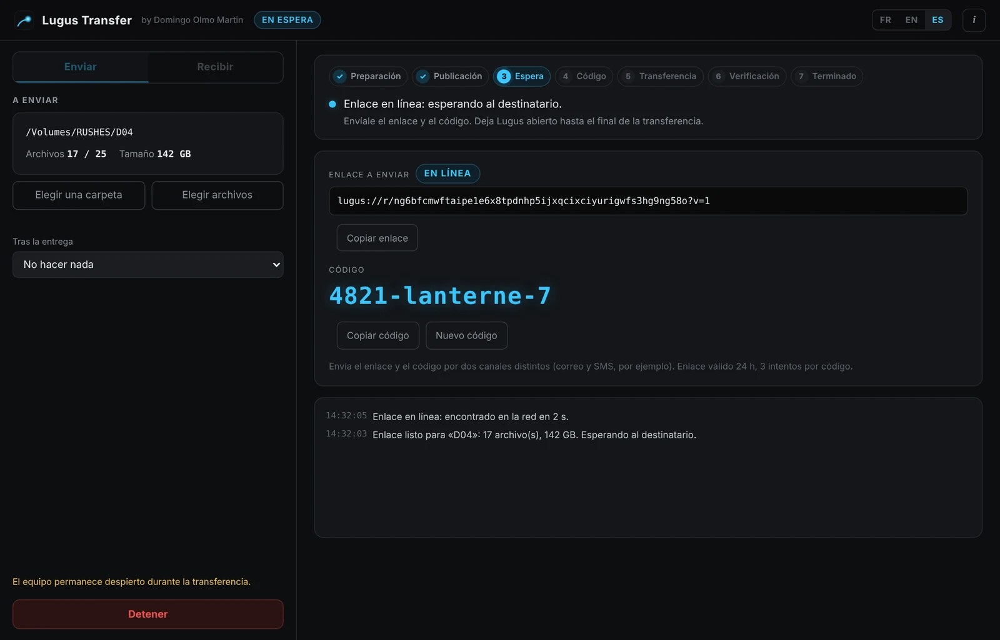
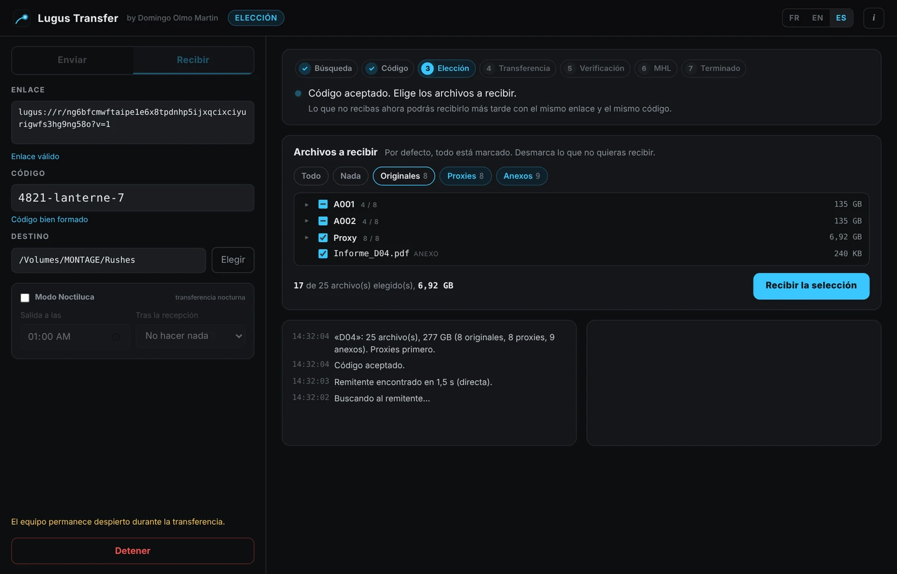
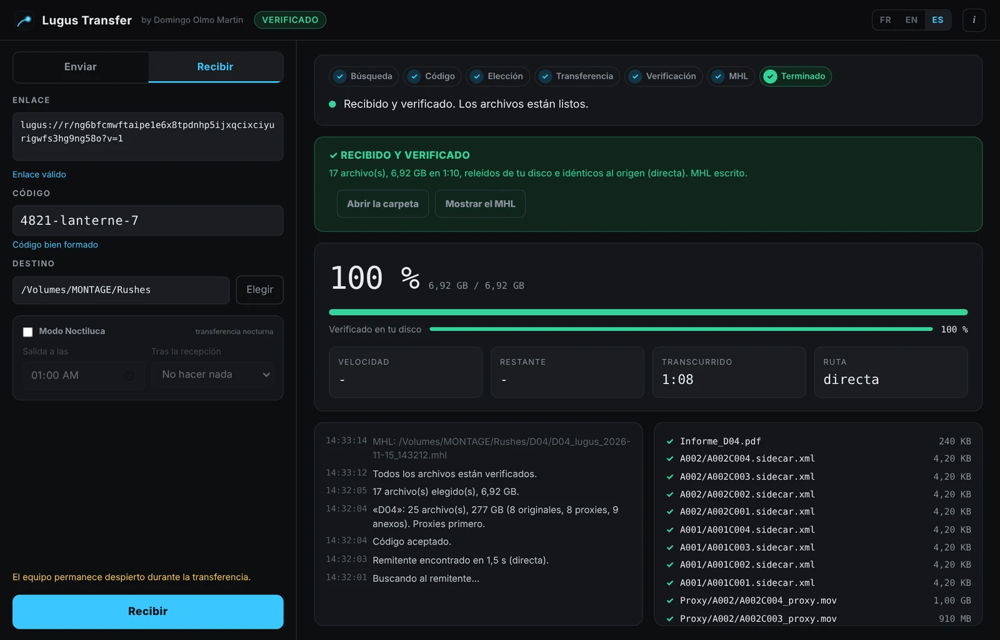

<p align="center">
  
</p>

<h1 align="center">Lugus Transfer</h1>
<p align="center"><b>by Domingo Olmo Martin</b></p>
<p align="center">
  <a href="README.md">English</a> · <a href="README.fr.md">Français</a> · <b>Español</b>
</p>

Lugus Transfer envía tu material directamente de un ordenador a otro, con un enlace y un código. Sin servidor que mantener, sin almacenamiento en la nube, sin cuenta. Cada archivo se relee en el disco del destinatario y se compara con el origen, y se escribe un MHL a la llegada.

Gratuito, para Windows y macOS. Interfaz en español, inglés y francés.

> Lugus es el dios mensajero de los celtíberos, dios de los caminos y los intercambios. Noctiluca, la diosa lunar de la costa tartésica, ilumina el camino y vela por las transferencias nocturnas.

<p align="center"></p>

## Descargar

Ve a la **[página de Releases](https://github.com/tetsujin28/lugus-transfer/releases)** y elige el archivo para tu ordenador:

| Sistema | Archivo |
|---|---|
| Windows (sin instalación) | `Lugus_Transfer_x.y.z_portable.exe` |
| Windows (instalador) | `Lugus_Transfer_x.y.z_x64-setup.exe` o `.msi` |
| macOS (Intel y Apple Silicon) | `Lugus_Transfer_x.y.z_universal.dmg` |
| Línea de comandos (opcional) | `lugus_x.y.z_windows.exe`, `lugus_x.y.z_macos` |

Los dos ordenadores necesitan Lugus Transfer. El remitente y el destinatario no necesitan el mismo sistema: un Mac puede enviar a un PC, y al revés.

**Primer arranque.** La aplicación todavía no está firmada, así que tu sistema mostrará un aviso una sola vez:
- **Windows**: haz clic en «Más información» y después en «Ejecutar de todas formas».
- **macOS**: haz doble clic en la aplicación y cierra el mensaje de bloqueo. Abre Ajustes del Sistema > Privacidad y seguridad, baja hasta la sección Seguridad y haz clic en «Abrir de todos modos» junto al nombre de la aplicación; confirma con la contraseña de sesión (solo se pide una vez). Si el botón no aparece, abre Terminal y escribe `xattr -dr com.apple.quarantine ` seguido de la aplicación arrastrada a la ventana.

Tu navegador también puede marcar la descarga como inusual o peligrosa: es habitual con una aplicación reciente y sin firmar. Conserva el archivo desde el panel de descargas y, si tienes dudas, analízalo en [VirusTotal](https://www.virustotal.com). Si tu sistema pregunta si Lugus Transfer puede usar la red, permítelo: así es como los dos ordenadores se encuentran.

## Qué hace

- **Transferencia directa.** Los archivos van de un ordenador al otro y no se guardan en ningún otro sitio. Los dos ordenadores deben estar encendidos, con Lugus Transfer abierto, al mismo tiempo.
- **Un enlace y un código.** El remitente crea un enlace (`lugus://r/…`) y un código corto como `4821-lanterne-7`, que se envían por dos canales distintos. El enlace es válido 24 horas, con 3 intentos por código.
- **Elige lo que envías, elige lo que recibes.** Suelta carpetas o archivos, de uno o varios discos, un depósito tras otro. Desmarca lo que no debe salir, y después el destinatario desmarca lo que no necesita de momento (originales, proxies, archivos anexos, o archivo por archivo).
- **Primero los proxies.** Los proxies y los archivos anexos llegan antes que los originales, para que el montaje pueda empezar antes.
- **Verificado en el disco del destinatario.** Cada archivo se relee desde el disco de destino evitando la caché del sistema, y se compara bloque a bloque, y entero, con el hash del origen (BLAKE3). Un archivo solo recibe su nombre definitivo cuando está verificado.
- **Se reanuda justo donde se detuvo.** Tras un corte de red, una ventana cerrada o un ordenador en reposo, vuelve a lanzar la recepción: se conserva cada bloque ya escrito y comprobado, y las dos pantallas muestran el mismo avance.
- **Un MHL a la llegada.** Se escribe un archivo MHL 1.1 en xxHash64 en la carpeta recibida, legible por [Bandua MHL Companion](https://github.com/tetsujin28/bandua-mhl-companion), Silverstack, ShotPut Pro, Hedge…
- **Acuse de recibo.** El remitente recibe un aviso cuando todo se ha recibido y verificado al otro lado.
- **Claro en cada paso.** Pasos numerados y una frase de estado indican lo que ocurre y lo que hay que hacer, también durante las últimas comprobaciones después del 100 %.
- **Mantiene el ordenador despierto** durante toda la transferencia.
- **Modo Noctiluca.** Programa la recepción para la noche (a la 01:00, por ejemplo) y suspende o apaga el ordenador cuando todo esté verificado.
- **Cifrado de extremo a extremo.** Incluso cuando la transferencia pasa por un relé público, solo los dos ordenadores pueden leer los archivos.

## Cómo se usa

**Para enviar**
1. Suelta carpetas o archivos en la ventana, o usa **Elegir una carpeta** / **Elegir archivos**. Cada depósito se suma al anterior: puedes enviar el material de dos discos o de dos carpetas a la vez.
2. Desmarca lo que no quieras enviar y haz clic en **Crear el enlace**.
3. Envía el **enlace** y el **código** al destinatario, por dos canales distintos (correo y SMS, por ejemplo).
4. Deja Lugus Transfer abierto hasta **ENTREGADO Y VERIFICADO**.

**Para recibir**
1. Pega el enlace, escribe el código y elige la carpeta de destino.
2. Haz clic en **Recibir**, elige los archivos que quieres y haz clic en **Recibir la selección**.
3. Espera a **RECIBIDO Y VERIFICADO**. El MHL está en la carpeta recibida.

El **[manual de uso completo](docs/GUIDE.es.md)** recorre cada pantalla, el modo Noctiluca, las interrupciones y qué hacer cuando algo va mal.

## Capturas de pantalla

<table>
  <tr>
    <td width="50%"><br><sub>Elección de los archivos a recibir</sub></td>
    <td width="50%"><br><sub>Recibido y verificado</sub></td>
  </tr>
</table>

## Por dentro

- **Descubrimiento**: el remitente publica sus direcciones, firmadas con una clave de un solo uso, en la DHT Mainline de BitTorrent. Ningún servidor que mantener.
- **Conexión**: QUIC ([iroh](https://www.iroh.computer)), directa siempre que es posible (red local, IPv6, puertos abiertos automáticamente con UPnP, PCP o NAT-PMP, hole punching). Si no, recurre a los relés públicos de iroh, donde el tráfico sigue cifrado de extremo a extremo.
- **Código**: `NNNN-palabra-C`, 4 cifras, una palabra entre 2048 y un dígito de control (algoritmo de Damm). Las erratas se detectan en el ordenador del destinatario, sin gastar ningún intento. 3 intentos por código, con una espera creciente entre intentos. Tras 3 fallos, solo se sustituye el código, el enlace sigue siendo el mismo.
- **Autenticación**: SPAKE2, ligada a las claves de los dos ordenadores y a la sesión TLS. El remitente solo demuestra que conoce el código después de comprobar la prueba del destinatario.
- **Transferencia**: bloques de 4 MiB, 4 archivos en paralelo. Cada bloque se comprueba con su hash antes de escribirse, y se anota en un diario (`.lugus-journal`) que sirve para reanudar.
- **Verificación**: los archivos se escriben como `.lugus-part`, se releen sin la caché del sistema (`FILE_FLAG_NO_BUFFERING`, `F_NOCACHE`, `posix_fadvise`), se comparan bloque a bloque y enteros con el BLAKE3 del origen, y después reciben su fecha original y su nombre definitivo.

## Línea de comandos

La herramienta `lugus` hace lo mismo que la aplicación, para scripts o un ordenador sin pantalla:

```
lugus send <archivo o carpeta> [--apres veille|extinction]
lugus receive <enlace> --code <código> --dest <carpeta> [--depart 01:00] [--apres veille|extinction]
lugus code [código a comprobar]
```

## Compilar desde el código

Se necesita [Rust](https://rustup.rs) 1.91 o posterior. No hace falta npm.

```
cargo test --workspace --exclude lugus-app
cargo install tauri-cli --version "^2" --locked
cd src-tauri
cargo tauri dev      # ejecutar
cargo tauri build    # generar los instaladores
```

Cada Release publicada genera automáticamente los archivos de Windows y macOS con GitHub Actions.

Organización: `crates/` (motor en Rust: enlace y código, red, autenticación, almacenamiento y verificación, transferencia, línea de comandos), `src-tauri/` (aplicación de escritorio), `ui/` (interfaz, HTML/CSS/JS sencillo). Abierto en un navegador, `ui/index.html` funciona en modo demo con datos simulados.

## Apps hermanas

- [Bandua](https://github.com/tetsujin28/bandua): volcar las tarjetas de cámara y verificar cada copia.
- [Bandua MHL Companion](https://github.com/tetsujin28/bandua-mhl-companion): comprobar el material recibido con su MHL.
- [Ataecina](https://github.com/tetsujin28/ataecina): recuperar y reparar material perdido.

## Licencia y aviso

© 2026 Domingo Olmo Martin. Publicado bajo [licencia MIT](LICENSE).

Lugus Transfer se proporciona «tal cual», sin ninguna garantía. Ayuda a transferir y verificar medios, pero no sustituye tus propias comprobaciones ni tus procedimientos de copia de seguridad. El autor no se hace responsable de ninguna pérdida o corrupción de datos, ni de ningún daño derivado del uso del software. **No borres nunca el original sin haber comprobado que la copia recibida está completa y es legible.**
