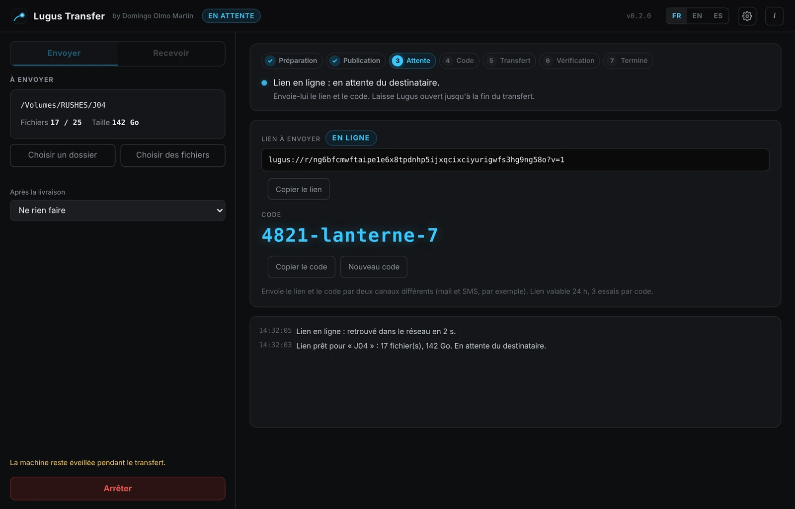
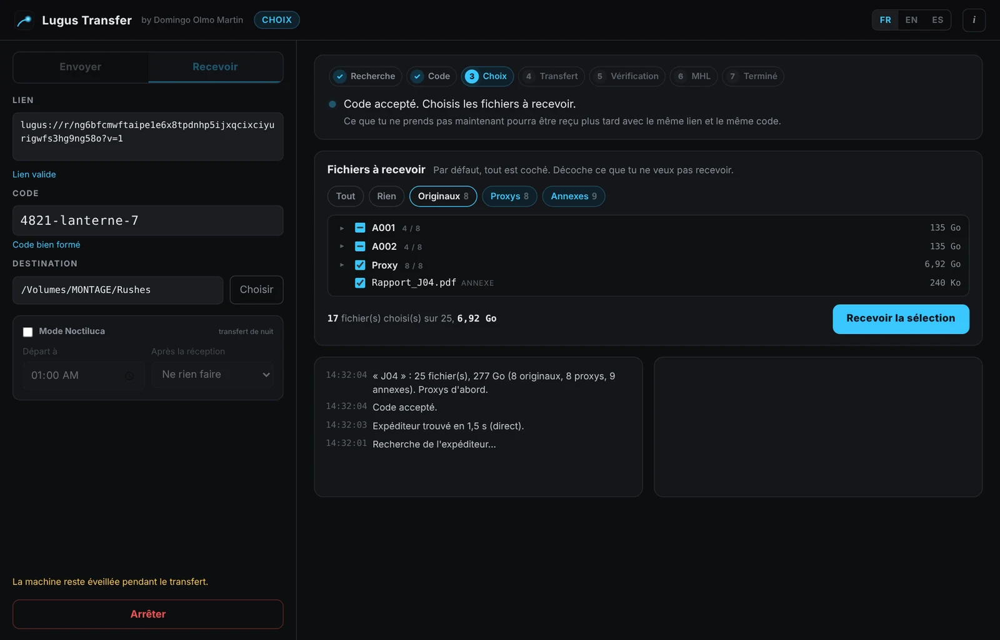
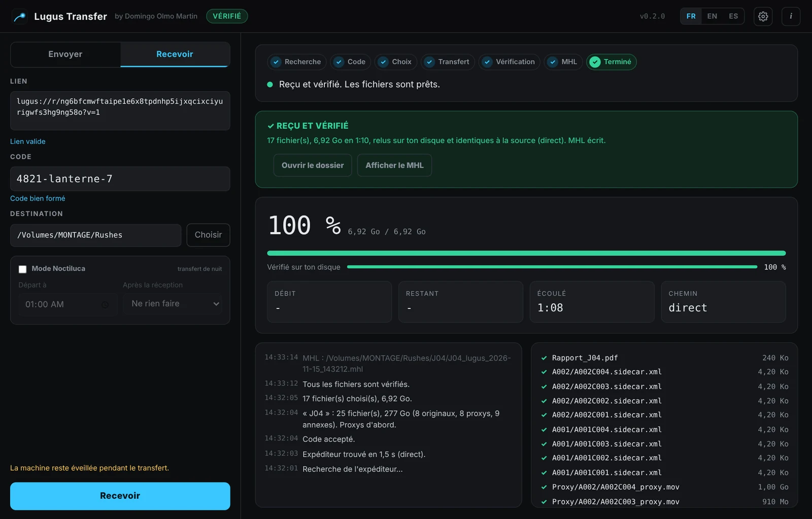

<p align="center">
  
</p>

<h1 align="center">Lugus Transfer</h1>
<p align="center"><b>by Domingo Olmo Martin</b></p>
<p align="center">
  <a href="README.md">English</a> · <b>Français</b> · <a href="README.es.md">Español</a>
</p>

Lugus Transfer envoie vos rushes directement d'un ordinateur à l'autre, avec un lien et un code. Pas de serveur à maintenir, pas de stockage dans le cloud, pas de compte. Chaque fichier est relu sur le disque du destinataire et comparé à la source, et un MHL est écrit à l'arrivée.

Gratuit, pour Windows et macOS. Interface en français, anglais et espagnol.

> Lugus est le dieu messager des Celtibères, dieu des chemins et des échanges. Noctiluca, la déesse lunaire de la côte tartessienne, éclaire le chemin et veille sur les transferts de nuit.

<p align="center"></p>

## Téléchargement

Rendez-vous sur la **[page des Releases](https://github.com/tetsujin28/lugus-transfer/releases)** et choisissez le fichier pour votre ordinateur :

| Système | Fichier |
|---|---|
| Windows (sans installation) | `Lugus_Transfer_x.y.z_portable.exe` |
| Windows (installateur) | `Lugus_Transfer_x.y.z_x64-setup.exe` ou `.msi` |
| macOS (Intel et Apple Silicon) | `Lugus_Transfer_x.y.z_universal.dmg` |
| Ligne de commande (facultatif) | `lugus_x.y.z_windows.exe`, `lugus_x.y.z_macos` |

Les deux ordinateurs ont besoin de Lugus Transfer. L'expéditeur et le destinataire n'ont pas besoin du même système : un Mac peut envoyer à un PC, et inversement.

**Premier lancement.** L'application n'est pas encore signée : votre système affiche un avertissement, une seule fois.
- **Windows** : cliquez sur « Informations complémentaires », puis « Exécuter quand même ».
- **macOS** : double-cliquez sur l'application, puis fermez le message de blocage. Ouvrez Réglages Système > Confidentialité et sécurité, descendez jusqu'à la section Sécurité et cliquez sur « Ouvrir quand même » à côté du nom de l'application ; confirmez avec le mot de passe de session (demandé une seule fois). Si le bouton n'apparaît pas, ouvrez le Terminal et tapez `xattr -dr com.apple.quarantine ` suivi de l'application glissée dans la fenêtre.

Votre navigateur peut aussi signaler le téléchargement comme inhabituel ou dangereux : c'est courant pour une application récente et non signée. Gardez le fichier depuis le panneau des téléchargements et, en cas de doute, faites-le analyser sur [VirusTotal](https://www.virustotal.com). Si votre système demande si Lugus Transfer peut utiliser le réseau, autorisez-le : c'est ainsi que les deux ordinateurs se joignent.

## Ce qu'il fait

- **Transfert direct.** Les fichiers vont d'un ordinateur à l'autre et ne sont stockés nulle part ailleurs. Les deux ordinateurs doivent être allumés, avec Lugus Transfer ouvert, en même temps.
- **Un lien et un code.** L'expéditeur crée un lien (`lugus://r/…`) et un code court comme `4821-lanterne-7`, à transmettre par deux canaux différents. Le lien est valable 24 heures, avec 3 essais par code.
- **Choisir ce qu'on envoie, choisir ce qu'on reçoit.** Déposez des dossiers ou des fichiers, d'un ou de plusieurs disques, un dépôt après l'autre. Décochez ce qui ne doit pas partir, puis le destinataire décoche ce dont il n'a pas besoin tout de suite (originaux, proxys, fichiers annexes, ou fichier par fichier).
- **Les proxys d'abord.** Les proxys et les fichiers annexes arrivent avant les originaux : le montage peut commencer plus tôt.
- **Vérifié sur le disque du destinataire.** Chaque fichier est relu sur le disque de destination en contournant le cache du système, puis comparé bloc par bloc, et en entier, au hash de la source (BLAKE3). Un fichier ne prend son nom définitif qu'une fois vérifié.
- **Reprend exactement là où il s'est arrêté.** Après une coupure du réseau, une fenêtre fermée ou un ordinateur mis en veille, relancez la réception : chaque bloc déjà écrit et contrôlé est conservé, et les deux écrans affichent le même avancement.
- **Un MHL à l'arrivée.** Un fichier MHL 1.1 en xxHash64 est écrit dans le dossier reçu, lisible par [Bandua MHL Companion](https://github.com/tetsujin28/bandua-mhl-companion), Silverstack, ShotPut Pro, Hedge…
- **Accusé de réception.** L'expéditeur est prévenu quand tout a été reçu et vérifié de l'autre côté.
- **Clair à chaque étape.** Des étapes numérotées et une phrase d'état disent ce qui se passe et ce qu'il faut faire, y compris pendant les derniers contrôles après 100 %.
- **Garde l'ordinateur éveillé** pendant tout le transfert.
- **Mode Noctiluca.** Programmez la réception pour la nuit (01:00 par exemple), puis mettez l'ordinateur en veille ou éteignez-le une fois tout vérifié.
- **Chiffré de bout en bout.** Même quand le transfert passe par un relais public, seuls les deux ordinateurs peuvent lire les fichiers.

## Comment s'en servir

**Pour envoyer**
1. Déposez des dossiers ou des fichiers sur la fenêtre, ou utilisez **Choisir un dossier** / **Choisir des fichiers**. Chaque dépôt s'ajoute au précédent : vous pouvez envoyer les rushes de deux disques ou de deux dossiers en même temps.
2. Décochez ce que vous ne voulez pas envoyer, puis cliquez sur **Créer le lien**.
3. Transmettez le **lien** et le **code** au destinataire, par deux canaux différents (mail et SMS, par exemple).
4. Laissez Lugus Transfer ouvert jusqu'à **LIVRÉ ET VÉRIFIÉ**.

**Pour recevoir**
1. Collez le lien, tapez le code et choisissez le dossier de destination.
2. Cliquez sur **Recevoir**, choisissez les fichiers voulus, puis cliquez sur **Recevoir la sélection**.
3. Attendez **REÇU ET VÉRIFIÉ**. Le MHL se trouve dans le dossier reçu.

Le **[mode d'emploi détaillé](docs/GUIDE.fr.md)** décrit chaque écran, le mode Noctiluca, les interruptions et la marche à suivre en cas de problème.

## Captures d'écran

<table>
  <tr>
    <td width="50%"><br><sub>Choix des fichiers à recevoir</sub></td>
    <td width="50%"><br><sub>Reçu et vérifié</sub></td>
  </tr>
</table>

## Sous le capot

- **Découverte** : l'expéditeur publie ses adresses, signées par une clé à usage unique, dans la DHT Mainline de BitTorrent. Aucun serveur à maintenir.
- **Connexion** : QUIC ([iroh](https://www.iroh.computer)), directe chaque fois que c'est possible (réseau local, IPv6, ports ouverts automatiquement en UPnP, PCP ou NAT-PMP, hole punching). Sinon, repli sur les relais publics d'iroh, où le trafic reste chiffré de bout en bout.
- **Code** : `NNNN-mot-C`, 4 chiffres, un mot parmi 2048 et un chiffre de contrôle (algorithme de Damm). Les fautes de frappe sont détectées sur l'ordinateur du destinataire, sans consommer d'essai. 3 essais par code, avec un délai croissant entre deux essais. Après 3 échecs, seul le code est remplacé, le lien reste le même.
- **Authentification** : SPAKE2, liée aux clés des deux ordinateurs et à la session TLS. L'expéditeur ne prouve qu'il connaît le code qu'après avoir vérifié la preuve du destinataire.
- **Transfert** : blocs de 4 Mio, 4 fichiers en parallèle. Chaque bloc est contrôlé par son hash avant d'être écrit, puis noté dans un journal (`.lugus-journal`) qui sert à la reprise.
- **Vérification** : les fichiers sont écrits en `.lugus-part`, relus sans le cache du système (`FILE_FLAG_NO_BUFFERING`, `F_NOCACHE`, `posix_fadvise`), comparés bloc par bloc et en entier au BLAKE3 de la source, puis reçoivent leur date d'origine et leur nom définitif.

## Ligne de commande

L'outil `lugus` fait la même chose que l'application, pour des scripts ou un ordinateur sans écran :

```
lugus send <fichier ou dossier> [--apres veille|extinction]
lugus receive <lien> --code <code> --dest <dossier> [--depart 01:00] [--apres veille|extinction]
lugus code [code à vérifier]
```

## Compilation

Il faut [Rust](https://rustup.rs) 1.91 ou plus récent. Pas besoin de npm.

```
cargo test --workspace --exclude lugus-app
cargo install tauri-cli --version "^2" --locked
cd src-tauri
cargo tauri dev      # lancer
cargo tauri build    # fabriquer les installateurs
```

Chaque Release publiée fabrique automatiquement les fichiers Windows et macOS avec GitHub Actions.

Organisation : `crates/` (moteur en Rust : lien et code, réseau, authentification, stockage et vérification, transfert, ligne de commande), `src-tauri/` (application de bureau), `ui/` (interface, HTML/CSS/JS simple). Ouvert dans un navigateur, `ui/index.html` tourne en mode démo avec des données simulées.

## Apps sœurs

- [Bandua](https://github.com/tetsujin28/bandua) : décharger les cartes caméra et vérifier chaque copie.
- [Bandua MHL Companion](https://github.com/tetsujin28/bandua-mhl-companion) : contrôler les rushes reçus avec leur MHL.
- [Ataecina](https://github.com/tetsujin28/ataecina) : récupérer et réparer les rushes perdus.

## Licence et avertissement

© 2026 Domingo Olmo Martin. Publié sous [licence MIT](LICENSE).

Lugus Transfer est fourni « tel quel », sans aucune garantie. Il aide à transférer et vérifier des médias mais ne remplace pas vos propres contrôles ni vos procédures de sauvegarde. L'auteur ne pourra être tenu responsable d'aucune perte ou corruption de données, ni d'aucun dommage résultant de l'utilisation du logiciel. **Ne supprimez jamais l'original avant d'avoir vérifié que la copie reçue est complète et lisible.**
