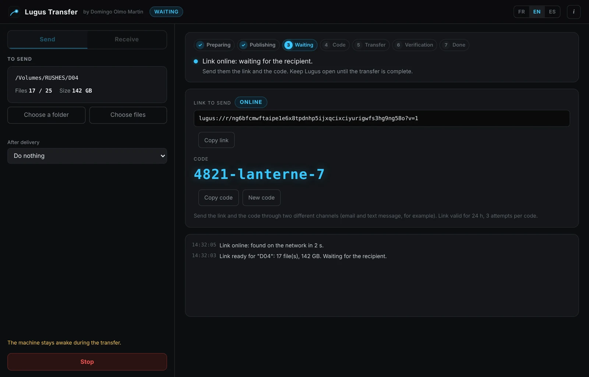
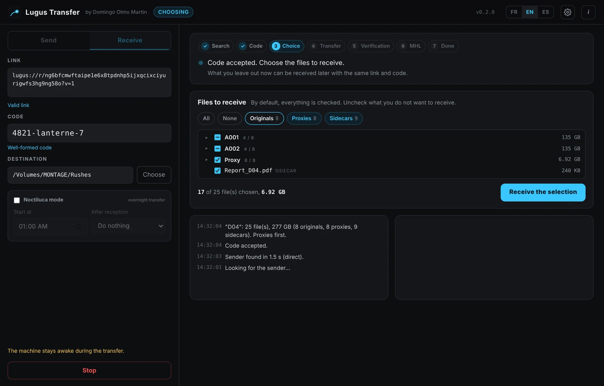
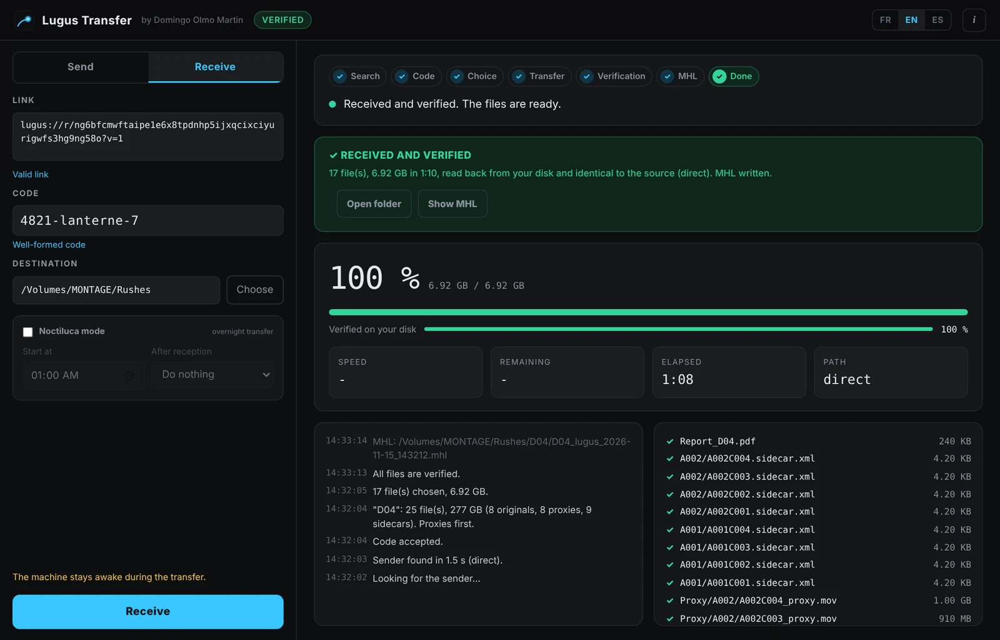

<p align="center">
  
</p>

<h1 align="center">Lugus Transfer</h1>
<p align="center"><b>by Domingo Olmo Martin</b></p>
<p align="center">
  <b>English</b> · <a href="README.fr.md">Français</a> · <a href="README.es.md">Español</a>
</p>

Lugus Transfer sends footage straight from one computer to another, with a link and a code. No server to run, no cloud storage, no account. Every file is read back from the recipient's disk and compared with the source, and an MHL is written on arrival.

Free, for Windows and macOS. Interface in English, French and Spanish.

> Lugus is the messenger god of the Celtiberians, god of roads and exchanges. Noctiluca, the moon goddess of the Tartessian coast, lights the way and watches over overnight transfers.

<p align="center"></p>

## Download

Go to the **[Releases page](https://github.com/tetsujin28/lugus-transfer/releases)** and pick the file for your computer:

| System | File |
|---|---|
| Windows (no install) | `Lugus_Transfer_x.y.z_portable.exe` |
| Windows (installer) | `Lugus_Transfer_x.y.z_x64-setup.exe` or `.msi` |
| macOS (Intel and Apple Silicon) | `Lugus_Transfer_x.y.z_universal.dmg` |
| Command line (optional) | `lugus_x.y.z_windows.exe`, `lugus_x.y.z_macos` |

Both computers need Lugus Transfer. The sender and the recipient do not need the same system: a Mac can send to a PC and the other way round.

**First launch.** The app is not signed yet, so your system will warn you once:
- **Windows**: click "More info", then "Run anyway".
- **macOS**: double-click the app, then close the blocking message. Open System Settings > Privacy & Security, scroll down to the Security section and click "Open Anyway" next to the app's name, then confirm with your session password (asked only once). If the button does not appear, open Terminal and type `xattr -dr com.apple.quarantine ` followed by the app dragged onto the window.

Your browser may also flag the download as unusual or dangerous: this is common for new, unsigned apps. Keep the file from the downloads panel, and if in doubt, check it on [VirusTotal](https://www.virustotal.com). If your system asks whether Lugus Transfer may use the network, allow it: that is how the two computers reach each other.

## What it does

- **Direct transfer.** The files go from one computer to the other and are stored nowhere else. Both computers must be on and running Lugus Transfer at the same time.
- **A link and a code.** The sender creates a link (`lugus://r/…`) and a short code such as `4821-lanterne-7`, to send through two different channels. The link is valid for 24 hours, with 3 attempts per code.
- **Choose what you send, choose what you receive.** Drop a folder, one file or several files. Untick what should not go, then the recipient unticks what they do not need right now (originals, proxies, sidecar files, or file by file).
- **Proxies first.** Proxies and sidecar files arrive before the originals, so the editor can start sooner.
- **Verified on the recipient's disk.** Each file is read back from the destination disk with the system cache bypassed, and compared block by block, then as a whole, with the hash of the source (BLAKE3). A file only gets its final name once it is verified.
- **Resumes exactly where it stopped.** After a network cut, a closed window or a computer gone to sleep, start the reception again: every block already written and checked is kept, and both screens show the same progress.
- **MHL on arrival.** An MHL 1.1 file in xxHash64 is written in the received folder, readable by [Bandua MHL Companion](https://github.com/tetsujin28/bandua-mhl-companion), Silverstack, ShotPut Pro, Hedge…
- **Delivery receipt.** The sender is told when everything has been received and verified on the other side.
- **Clear at every step.** Numbered steps and a status line say what is happening and what to do, including during the final checks after 100 %.
- **Keeps the computer awake** during the whole transfer.
- **Noctiluca mode.** Schedule the reception for the night (01:00 for example), then put the computer to sleep or shut it down once everything is verified.
- **Encrypted end to end.** Even when the transfer goes through a public relay, nobody but the two computers can read the files.

## How to use it

**To send**
1. Drop a folder or files on the window, or use **Choose a folder** / **Choose files**.
2. Untick what you do not want to send, then click **Create the link**.
3. Send the **link** and the **code** to the recipient, through two different channels (email and text message, for example).
4. Leave Lugus Transfer open until **DELIVERED AND VERIFIED**.

**To receive**
1. Paste the link, type the code and choose the destination folder.
2. Click **Receive**, then choose the files you want and click **Receive the selection**.
3. Wait for **RECEIVED AND VERIFIED**. The MHL is in the received folder.

The **[full user guide](docs/GUIDE.md)** walks through every screen, the Noctiluca mode, interruptions and what to do when something goes wrong.

## Screenshots

<table>
  <tr>
    <td width="50%"><br><sub>Choosing the files to receive</sub></td>
    <td width="50%"><br><sub>Received and verified</sub></td>
  </tr>
</table>

## Under the hood

- **Discovery**: the sender publishes its addresses, signed with a one-time key, in the BitTorrent Mainline DHT. No server to maintain.
- **Connection**: QUIC ([iroh](https://www.iroh.computer)), direct whenever possible (local network, IPv6, ports opened automatically with UPnP, PCP or NAT-PMP, hole punching). Otherwise, falls back on iroh's public relays, where traffic stays encrypted end to end.
- **Code**: `NNNN-word-C`, 4 digits, one word out of 2048 and a check digit (Damm algorithm). Typos are caught on the recipient's computer, without using up an attempt. 3 attempts per code, with a growing delay between attempts. After 3 failures, only the code is replaced, the link stays the same.
- **Authentication**: SPAKE2, bound to the keys of both computers and to the TLS session. The sender only proves it knows the code after checking the recipient's proof.
- **Transfer**: 4 MiB blocks, 4 files in parallel. Each block is checked against its hash before being written, and logged in a journal (`.lugus-journal`) used to resume.
- **Verification**: files are written as `.lugus-part`, read back without the system cache (`FILE_FLAG_NO_BUFFERING`, `F_NOCACHE`, `posix_fadvise`), compared block by block and as a whole with the BLAKE3 hash of the source, then given their original date and final name.

## Command line

The `lugus` tool does the same as the app, for scripts or a computer without a screen:

```
lugus send <file or folder> [--apres veille|extinction]
lugus receive <link> --code <code> --dest <folder> [--depart 01:00] [--apres veille|extinction]
lugus code [code to check]
```

## Build from source

Requires [Rust](https://rustup.rs) 1.91 or later. No npm needed.

```
cargo test --workspace --exclude lugus-app
cargo install tauri-cli --version "^2" --locked
cd src-tauri
cargo tauri dev      # run
cargo tauri build    # build installers
```

Every published Release builds the Windows and macOS files automatically with GitHub Actions.

Project layout: `crates/` (engine in Rust: link and code, network, authentication, storage and verification, transfer, command line), `src-tauri/` (desktop app), `ui/` (interface, plain HTML/CSS/JS). Opened in a browser, `ui/index.html` runs in demo mode with simulated data.

## Sister apps

- [Bandua](https://github.com/tetsujin28/bandua): offload camera cards and verify every copy.
- [Bandua MHL Companion](https://github.com/tetsujin28/bandua-mhl-companion): check received footage against its MHL.
- [Ataecina](https://github.com/tetsujin28/ataecina): recover and repair lost footage.

## License and disclaimer

© 2026 Domingo Olmo Martin. Released under the [MIT License](LICENSE).

Lugus Transfer is provided "as is", without any warranty. It helps you transfer and verify media but does not replace your own checks and backup procedures. The author cannot be held responsible for any loss or corruption of data, or for any damage resulting from the use of the software. **Never delete the original before checking that the received copy is complete and readable.**
