

  

<h1 align="center">Lugus Transfer, manual de uso</h1>

<b>Versión 0.1.0 (beta) · Windows y macOS</b>

  <a href="GUIDE.md">English</a> · <a href="GUIDE.fr.md">Français</a> · <b>Español</b>

## Índice

1. [Presentación](#1-presentación)
2. [Instalación](#2-instalación)
3. [La interfaz de un vistazo](#3-la-interfaz-de-un-vistazo)
4. [Enviar material, paso a paso](#4-enviar-material-paso-a-paso)
5. [Recibir material, paso a paso](#5-recibir-material-paso-a-paso)
6. [Modo Noctiluca: recibir de noche](#6-modo-noctiluca-recibir-de-noche)
7. [Lo que hace Lugus Transfer para proteger tu material](#7-lo-que-hace-lugus-transfer-para-proteger-tu-material)
8. [Interrupciones y errores](#8-interrupciones-y-errores)
9. [Buenas prácticas](#9-buenas-prácticas)
10. [Preguntas frecuentes](#10-preguntas-frecuentes)
11. [Aviso y licencia](#11-aviso-y-licencia)

## 1. Presentación

Lugus Transfer envía tu material directamente de un ordenador a otro. El remitente crea un enlace y un código, el destinatario los introduce, y los archivos pasan directamente de una máquina a la otra, cifrados de extremo a extremo. Sin servidor en medio, sin almacenamiento en la nube y sin cuenta.

La regla es la misma que en el rodaje: **una transferencia solo termina cuando los archivos se han comprobado a la llegada.** Lugus Transfer relee cada archivo recibido en el disco del destinatario, lo compara con el origen y solo entonces lo declara «verificado». Se escribe un archivo MHL en la carpeta recibida, y el remitente recibe un acuse de recibo.

Lugus Transfer es gratuito, de código abierto (licencia MIT) y no pide ni cuenta ni licencia.

## 2. Instalación

### Descargar

Los archivos están en la [página de Releases](https://github.com/tetsujin28/lugus-transfer/releases):

| Sistema | Archivo |
|---|---|
| Windows, sin instalación | `Lugus_Transfer_x.y.z_portable.exe` |
| Windows, con instalador | `Lugus_Transfer_x.y.z_x64-setup.exe` o `.msi` |
| macOS (Intel y Apple Silicon) | `Lugus_Transfer_x.y.z_universal.dmg` |
| Línea de comandos (opcional) | `lugus_x.y.z_windows.exe`, `lugus_x.y.z_macos` |

El remitente y el destinatario necesitan Lugus Transfer, pero no el mismo sistema: un Mac puede enviar a un PC, y al revés.

### Primer arranque

La aplicación todavía no está firmada, así que tu sistema muestra un aviso, una sola vez:

- **Windows**: haz clic en «Más información» y después en «Ejecutar de todas formas».
- **macOS**: haz doble clic en la aplicación y cierra el mensaje de bloqueo. Abre Ajustes del Sistema > Privacidad y seguridad, baja hasta la sección Seguridad y haz clic en «Abrir de todos modos» junto al nombre de la aplicación; confirma con la contraseña de sesión (solo se pide una vez). Si el botón no aparece, abre Terminal y escribe `xattr -dr com.apple.quarantine ` seguido de la aplicación arrastrada a la ventana.

También puede que el navegador marque la descarga como inusual. Es habitual con una aplicación reciente y sin firmar. Conserva el archivo desde el panel de descargas. Si tienes dudas, analízalo en [VirusTotal](https://www.virustotal.com).

Si tu sistema o tu cortafuegos pregunta si Lugus Transfer puede usar la red, permítelo. Así es como los dos ordenadores se encuentran.

### Ventana de bienvenida

En el primer arranque, Lugus Transfer muestra un aviso de exención de responsabilidad (1). Léelo y haz clic en **Lo he entendido y acepto** (2). Lo encontrarás después en **Acerca de** (el botón *i*).

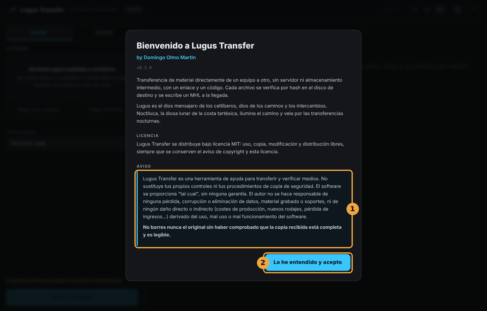

## 3. La interfaz de un vistazo

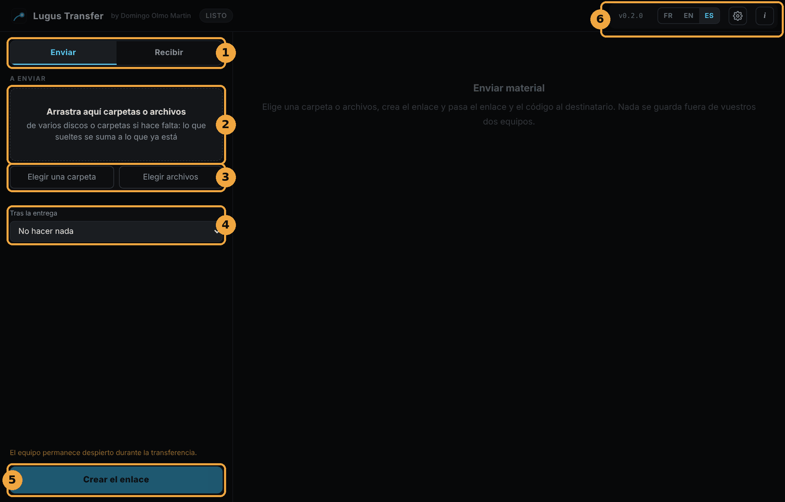

1. **Enviar / Recibir**: los dos modos de la aplicación. La misma aplicación sirve en los dos lados.
2. **Zona de depósito**: suelta aquí una carpeta, un archivo o varios archivos.
3. **Elegir una carpeta / Elegir archivos**: lo mismo con la ventana del sistema. «Elegir archivos» permite seleccionar varios a la vez.
4. **Tras la entrega**: no hacer nada, suspender el ordenador o apagarlo cuando el destinatario haya confirmado la entrega.
5. **Botón principal**: **Crear el enlace** para enviar, **Recibir** para recibir, y después **Detener** durante una transferencia.
6. **FR / EN / ES**: cambia al instante el idioma de la interfaz.
7. **Acerca de** (el botón *i*): versión, licencia y aviso.

Durante una transferencia, la parte derecha muestra:
- una fila de **pasos numerados**, con el paso actual resaltado;
- una **frase de estado**, en palabras sencillas, que dice lo que ocurre y lo que hay que hacer;
- el **avance**: porcentaje, una barra azul para los datos transferidos, una barra verde para los datos ya verificados en el disco del destinatario, velocidad, tiempo restante, tiempo transcurrido y camino de red (*red local*, *directa* o *relé*);
- el **registro** y, al recibir, la lista de **archivos verificados**.

Arriba, la etiqueta junto al nombre de la aplicación resume el estado: *Listo*, *Preparando*, *Publicando*, *En espera*, *Enviando*, *Buscando*, *Elección*, *Recibiendo*, *Noctiluca*, *Verificado*, *Error*, *Detenido*.

La línea **El equipo permanece despierto durante la transferencia** recuerda que Lugus Transfer impide que el ordenador entre en reposo solo mientras trabaja.

## 4. Enviar material, paso a paso

### Paso 1: elegir qué se envía

Suelta una carpeta en la ventana o haz clic en **Elegir una carpeta**. También puedes enviar:
- **un solo archivo**: llegará solo a la carpeta del destinatario;
- **varios archivos**: suéltalos juntos o selecciónalos con **Elegir archivos**. Deben venir de la misma carpeta.

Cuando eliges una carpeta o varios archivos, su contenido aparece a la derecha, todo marcado:

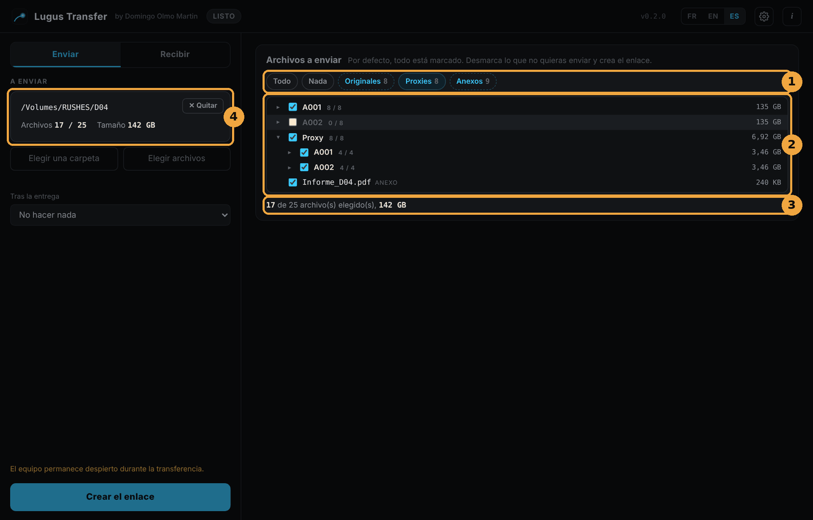

1. **Los filtros rápidos**: **Todo**, **Nada**, y después **Originales**, **Proxies** y **Anexos** (XML, LUT, sonido, informes…) con su número. Un clic marca o desmarca toda la categoría.
2. **El árbol** de la carpeta: haz clic en el nombre de una carpeta para abrirla, marca o desmarca un archivo o una carpeta entera. Una casilla a medio llenar significa que parte de la carpeta está elegida.
3. **El total** de lo que se enviará: número de archivos y tamaño.
4. **El resumen** de la izquierda muestra el mismo total, por ejemplo *Archivos 17 / 25*. El botón **✕ Quitar** lo borra todo para empezar de cero.

No hace falta hacer clic en Quitar para cambiar de idea: elegir otra carpeta u otros archivos sustituye sin más la elección anterior.

### Paso 2: tras la entrega (opcional)

En **Tras la entrega**, elige lo que hará el ordenador cuando el destinatario haya confirmado la entrega: **No hacer nada**, **Suspender** o **Apagar el ordenador**. Útil cuando envías un gran volumen antes de irte.

### Paso 3: crear el enlace

Haz clic en **Crear el enlace**. Lugus Transfer analiza los archivos y publica el enlace en la red:

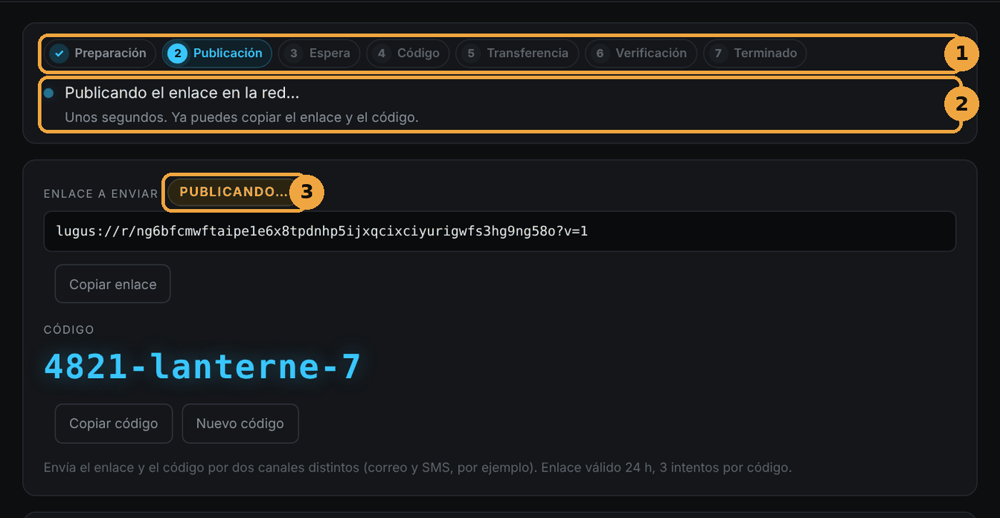

1. Los **pasos** pasan de *Preparación* a *Publicación*.
2. La **frase de estado** indica que el enlace se está publicando. Tarda unos segundos, y ya puedes copiar el enlace y el código.
3. La **etiqueta** junto al enlace muestra *Publicando…*.

En cuanto el enlace se puede encontrar en la red, la etiqueta cambia a **En línea**:

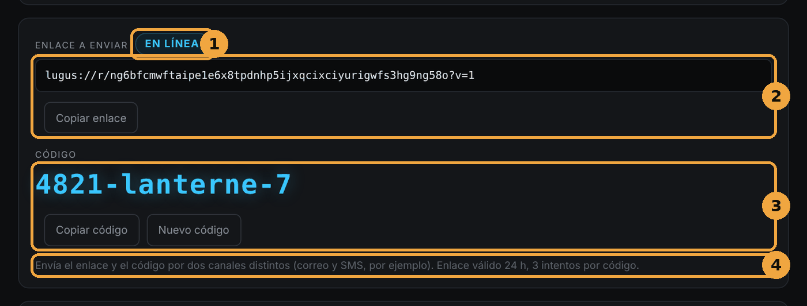

1. **En línea**: el destinatario ya puede llegar a tu ordenador. Si la etiqueta muestra *Aún no visible* después de 90 segundos, el enlace puede funcionar de todos modos: envíalo y deja Lugus Transfer abierto.
2. **El enlace** (`lugus://r/…`) y su botón **Copiar enlace**.
3. **El código** (por ejemplo `4821-lanterne-7`), con **Copiar código** y **Nuevo código**.
4. **El recordatorio**: envía el enlace y el código por **dos canales distintos**, por ejemplo el enlace por correo y el código por SMS. El enlace es válido 24 horas, con 3 intentos por código.

Quien solo tenga el enlace no puede hacer nada con él: también necesita el código.

### Paso 4: esperar al destinatario

Deja Lugus Transfer abierto. Cuando el destinatario introduce el código, la frase de estado indica que un destinatario se está conectando y que se está comprobando el código.

- **Código incorrecto**: el registro lo indica y muestra cuántos intentos quedan. El destinatario puede volver a intentarlo tras una breve espera.
- **3 intentos fallidos**: el código queda bloqueado. Haz clic en **Nuevo código** y envía el nuevo código. El enlace no cambia.
- **Código aceptado**: el destinatario elige los archivos que quiere. La frase de estado lo indica.

### Paso 5: la transferencia

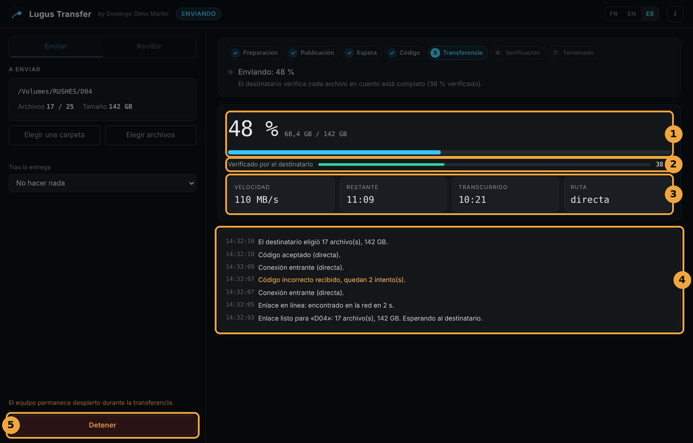

1. **El porcentaje y la barra azul**: lo que ha recibido el destinatario.
2. **La barra verde**: lo que ya se ha releído y verificado en el disco del destinatario. Cada archivo se verifica en cuanto está completo, así que la barra verde sigue a la azul.
3. **Velocidad, tiempo restante, tiempo transcurrido y camino de red.**
4. **El registro**: conexión, código, archivos elegidos por el destinatario.
5. **Detener**: termina la transferencia y cierra el enlace. No se pierde nada de lo ya recibido al otro lado (ver la sección 8).

Las cifras que se muestran son las del destinatario: tras una interrupción y una reanudación, las dos pantallas muestran el mismo porcentaje.

### Paso 6: la verificación en el equipo del destinatario

Cuando todo está enviado, la transferencia todavía no ha terminado. El destinatario relee los últimos archivos de su disco:

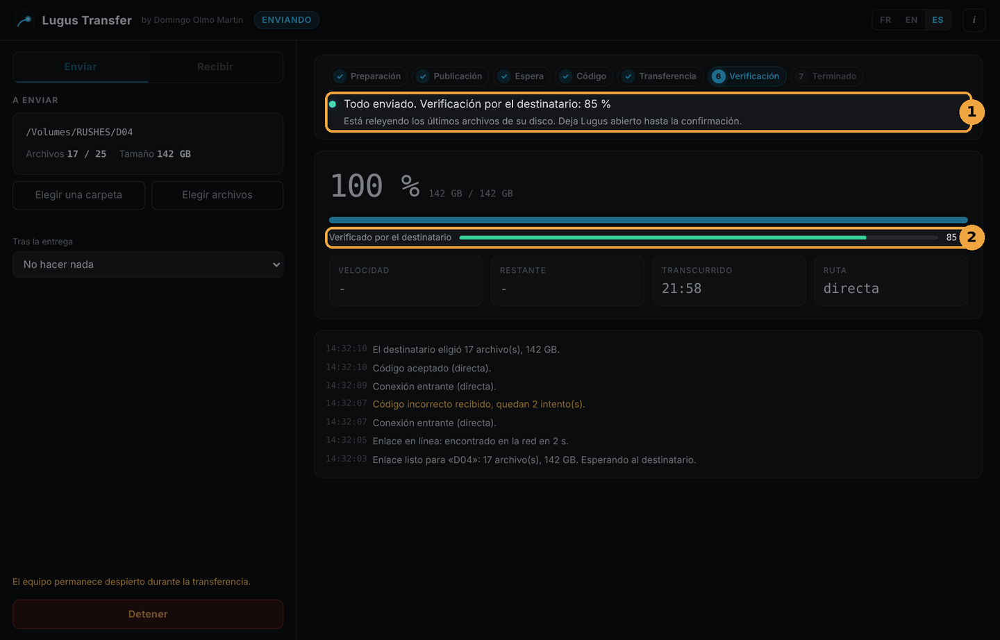

1. La **frase de estado** muestra *Todo enviado. Verificación por el destinatario*, con el porcentaje.
2. La **barra verde** sigue hasta el 100 %.

**Deja Lugus Transfer abierto hasta la confirmación.**

### Paso 7: entregado

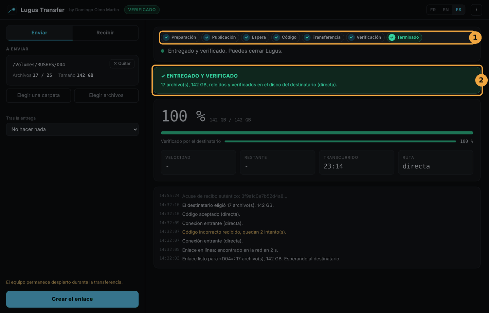

1. Todos los pasos están marcados y *Terminado* se pone en verde.
2. El aviso **✓ ENTREGADO Y VERIFICADO** da el número de archivos y el tamaño, releídos y verificados en el disco del destinatario.

El destinatario ha enviado un acuse de recibo autenticado: solo puede venir de la persona que introdujo el código correcto. Puedes cerrar Lugus Transfer. El enlace ya se ha usado: para enviar a otra persona, crea un nuevo enlace.

## 5. Recibir material, paso a paso

### Paso 1: enlace, código y destino

Haz clic en **Recibir**, arriba a la izquierda.

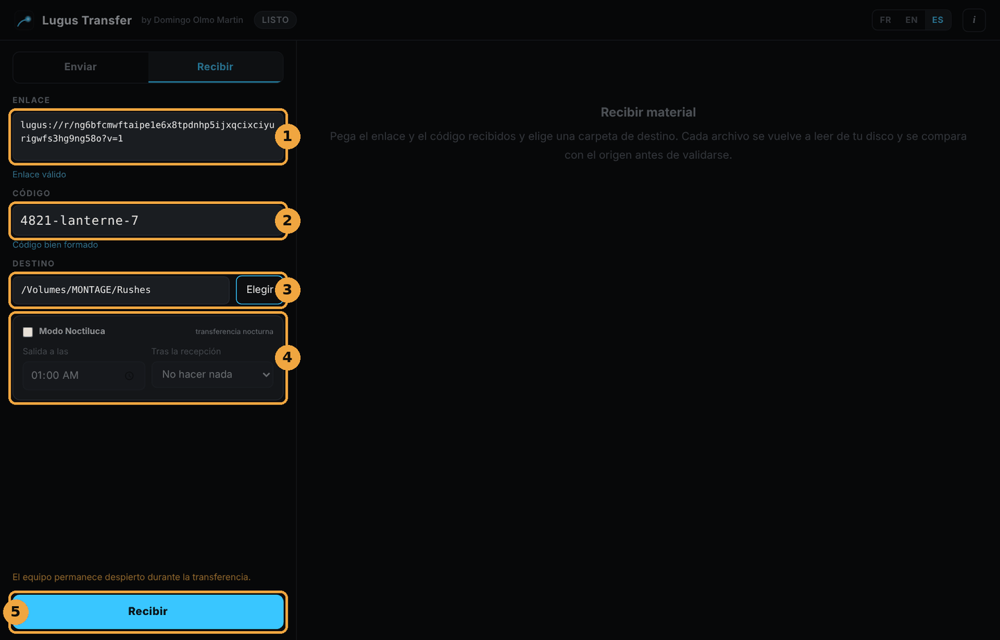

1. **Enlace**: pega el enlace que te han enviado. *Enlace válido* confirma su forma.
2. **Código**: escribe el código. Se comprueba en tu ordenador antes de cualquier envío: una errata se detecta en el acto y **nunca gasta un intento**.
3. **Destino**: haz clic en **Elegir** y selecciona la carpeta donde llegará el material. Una carpeta llega en una subcarpeta con su nombre, igual que varios archivos enviados juntos (con el nombre de la carpeta de la que vienen). Un archivo solo llega directamente al destino.
4. **Modo Noctiluca**: para recibir de noche (ver la sección 6).
5. **Recibir**: inicia la recepción.

Lugus Transfer busca entonces al remitente en la red. Suele tardar unos segundos. Si todavía no encuentra al remitente (habitual justo después de crear el enlace), Lugus Transfer lo reintenta solo durante 90 segundos y muestra el número de intento.

### Paso 2: elegir los archivos

Una vez aceptado el código, aparece el contenido que ofrece el remitente, todo marcado:

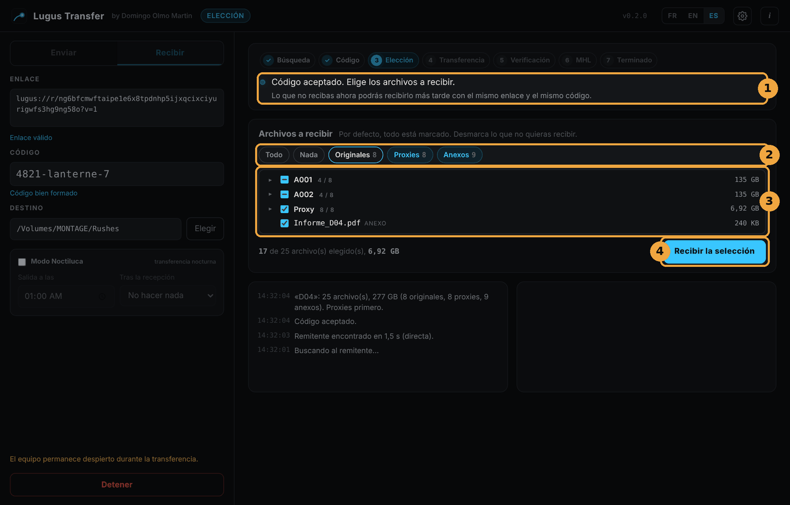

1. La **frase de estado** te pide que elijas los archivos.
2. **Los filtros rápidos**: **Todo**, **Nada**, **Originales**, **Proxies**, **Anexos**. Aquí se han desmarcado los originales para recibir primero los proxies.
3. **El árbol**, con una casilla para cada archivo y cada carpeta.
4. **Recibir la selección** inicia la transferencia.

Lo que dejes de lado ahora podrás recibirlo más tarde con el mismo enlace y el mismo código: los archivos ya recibidos y verificados se saltan.

### Paso 3: la transferencia

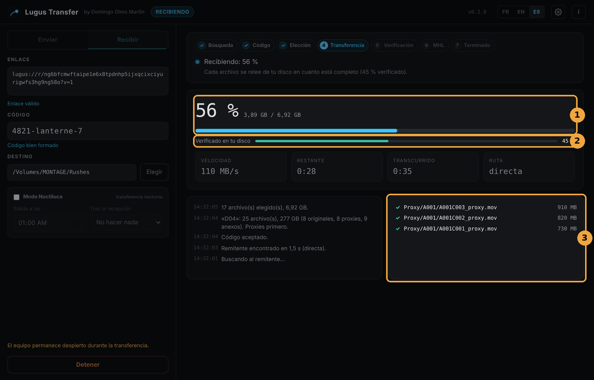

1. **El porcentaje y la barra azul**: lo que se ha recibido.
2. **La barra verde**: lo que ya se ha releído de tu disco y verificado.
3. **Los archivos verificados**, uno a uno, el más reciente arriba.

Los proxies y los archivos anexos llegan primero, después los originales. Se reciben hasta 4 archivos a la vez.

### Paso 4: la verificación en tu disco

Cuando todo está recibido, Lugus Transfer termina de releer los últimos archivos:

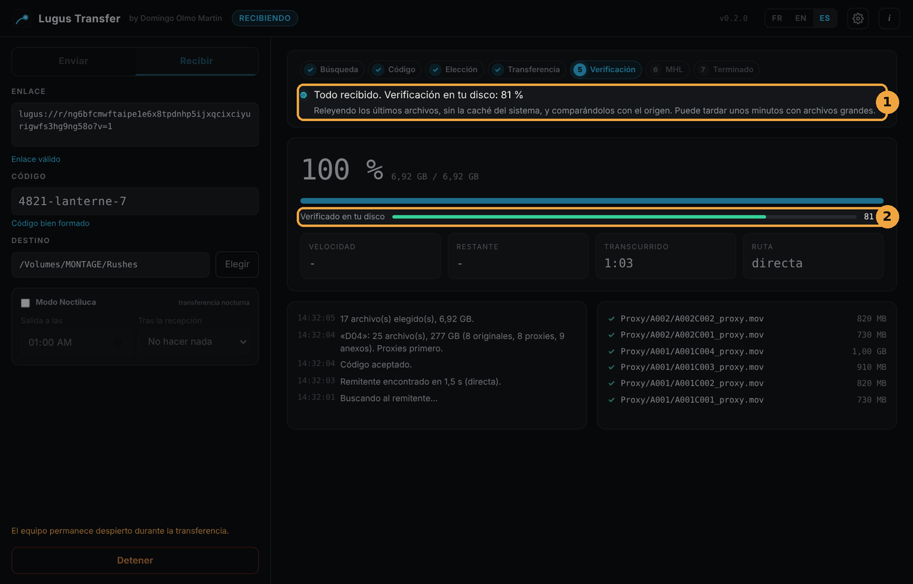

1. La **frase de estado** muestra *Todo recibido. Verificación en tu disco*, con el porcentaje. Con archivos grandes, puede tardar unos minutos: cada archivo se relee entero del disco, sin la caché del sistema, y se compara con el origen.
2. La **barra verde** sigue hasta el 100 %.

### Paso 5: MHL y acuse de recibo

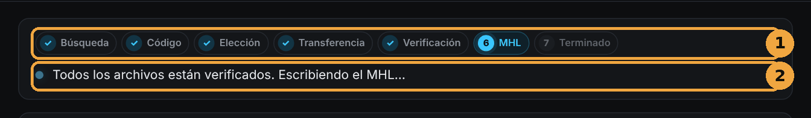

1. El paso *MHL* está activo.
2. La **frase de estado** indica que todos los archivos están verificados y que se está escribiendo el MHL, y después que el acuse de recibo sale hacia el remitente.

### Paso 6: recibido

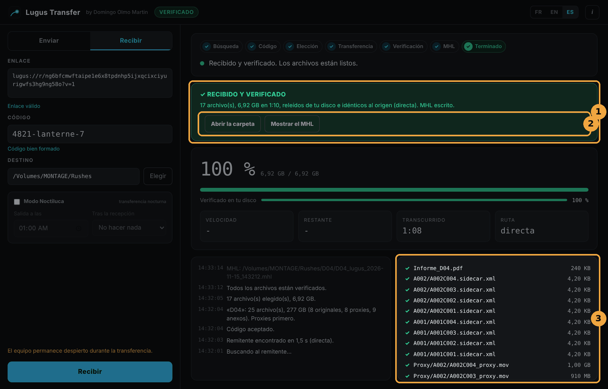

1. El aviso **✓ RECIBIDO Y VERIFICADO**: número de archivos, tamaño, duración y camino de red.
2. **Abrir la carpeta** abre la carpeta recibida, **Mostrar el MHL** muestra el archivo MHL.
3. **La lista de archivos verificados.**

El MHL se llama `<nombre>_lugus_<fecha>.mhl`, por ejemplo `D04_lugus_2026-11-15_143212.mhl`. Nunca sobrescribe un MHL que ya esté en la carpeta, como el que escribe Bandua en el rodaje.

## 6. Modo Noctiluca: recibir de noche

Las transferencias grandes se hacen mejor de noche, cuando la conexión está libre y nadie necesita el ordenador. El modo Noctiluca programa la recepción y se ocupa del final solo.

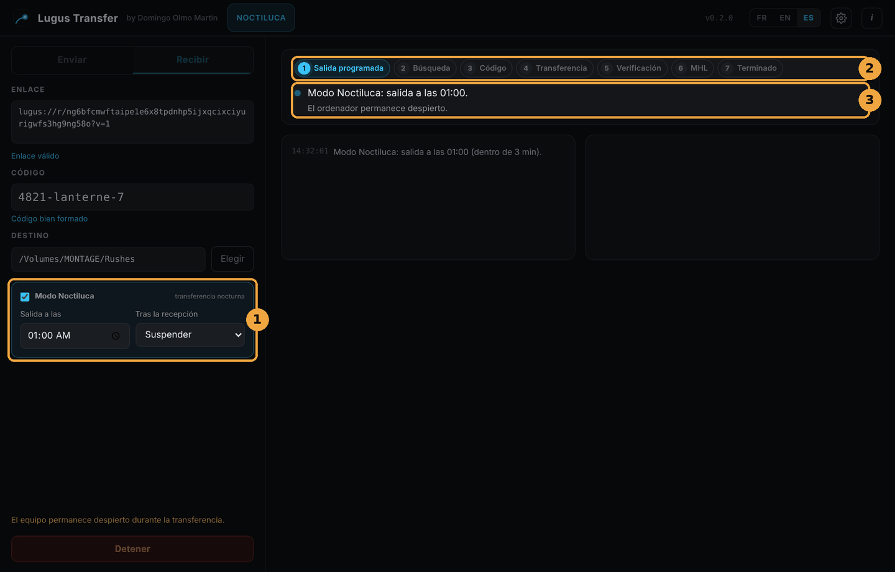

1. Marca **Modo Noctiluca**, ajusta la hora de **Salida a las** (la 01:00, por ejemplo) y elige qué ocurre **Tras la recepción**: no hacer nada, suspender o apagar el ordenador. Después haz clic en **Programar la recepción**.
2. Los pasos empiezan por *Salida programada*.
3. La frase de estado recuerda la hora de salida. El ordenador permanece despierto hasta entonces.

El enlace y el código se comprueban antes de la espera: una errata se ve en el acto, y no a la una de la madrugada. Si la hora ya ha pasado hoy, la recepción empieza al día siguiente a esa hora.

En modo Noctiluca no hay nadie para elegir los archivos: **se recibe todo lo que ofrece el remitente**. El ordenador del remitente debe estar encendido y Lugus Transfer abierto a la hora de salida.

Cuando todo está verificado, el ordenador se suspende o se apaga. En Windows, el apagado deja 60 segundos para cancelarlo.

## 7. Lo que hace Lugus Transfer para proteger tu material

Todo esto ocurre en segundo plano, sin nada que ajustar.

1. **Nada en medio.** Los archivos van de un ordenador al otro. Nunca se guardan en un servidor. Incluso cuando la conexión pasa por un relé público, sigue cifrada de extremo a extremo: el relé solo transmite datos que no puede leer.
2. **El código nunca viaja.** Los dos ordenadores se demuestran mutuamente que conocen el código (SPAKE2) sin enviarlo nunca. Quien intercepte el enlace no aprende nada, y solo tiene 3 intentos.
3. **Cada bloque se comprueba.** Los archivos viajan en bloques de 4 MB. El remitente calcula el hash de cada bloque al leerlo de su disco; el destinatario lo comprueba antes de escribir el bloque.
4. **Escritura segura.** Cada archivo se escribe primero con un nombre temporal (`.lugus-part`), con un diario (`.lugus-journal`) que anota cada bloque escrito. Un archivo solo recibe su nombre real **cuando está verificado**. Un archivo con su nombre definitivo es, por tanto, un archivo comprobado.
5. **Verificación en el disco, no en memoria.** Al final de cada archivo, el destinatario lo relee del disco evitando la caché del sistema, y compara cada bloque, y después el archivo entero, con el hash del origen (BLAKE3). Ante la menor diferencia, el archivo se rechaza y su avance se borra, para que se reciba de nuevo desde el principio.
6. **Fechas originales conservadas.** Los archivos recibidos toman la fecha de modificación del origen.
7. **Acuse de recibo autenticado.** Al final, el destinatario envía al remitente un acuse que solo él puede producir. Es lo que pone la pantalla del remitente en *Entregado y verificado*.

## 8. Interrupciones y errores

### Reanudar tras una interrupción

Corte de red, ventana cerrada, ordenador en reposo, **Detener** pulsado por error: la transferencia puede reanudarse justo donde se detuvo.

- **En el lado del remitente**, nada que hacer: Lugus Transfer sigue esperando, el enlace sigue siendo válido (24 horas). Si el remitente cerró Lugus Transfer o pulsó **Detener**, crea un nuevo enlace para los mismos archivos y lo envía.
- **En el lado del destinatario**, vuelve a lanzar la recepción con el enlace y el código (los mismos o los nuevos) y **el mismo destino**. Cada archivo se reanuda tras su último bloque escrito y comprobado; los archivos ya completos se releen y se verifican otra vez, y después se saltan.

Las dos pantallas muestran el mismo avance desde que los ordenadores vuelven a conectarse. Justo después de una reanudación, la barra verde puede empezar más abajo que la azul: los archivos ya presentes se releen una vez más antes de contar como verificados.

### Cuando algo va mal

| Lo que ves | Qué significa | Qué hacer |
|---|---|---|
| «Remitente aún no encontrado, nuevo intento…» | El enlace todavía no es visible en la red, o la red responde mal. | Espera: Lugus Transfer lo reintenta solo durante 90 segundos. |
| «Remitente no encontrado» (tras 90 segundos) | El ordenador del remitente está apagado o en reposo, Lugus Transfer está cerrado, o el enlace no es el correcto. | Comprueba con el remitente que Lugus Transfer está abierto y vuelve a empezar. |
| «Código incorrecto, quedan N intento(s)» | El código introducido no coincide. | Revisa el código. Espera unos segundos entre intentos. |
| «Este código está bloqueado» | Han fallado 3 intentos. | Pide un nuevo código al remitente (**Nuevo código**). El enlace no cambia. |
| «Conexión perdida» | La red se ha cortado, o el otro ordenador ha entrado en reposo o se ha cerrado. | Vuelve a lanzar la recepción con el mismo enlace y el mismo código: se reanuda donde se detuvo. |
| «Este enlace ha caducado» | Han pasado más de 24 horas. | El remitente crea un nuevo enlace. |
| «Ya existe en el destino otro archivo con el mismo nombre» | Un archivo con el mismo nombre, pero distinto, ya está en la carpeta de destino. | Elige otro destino o mueve el archivo antiguo. Lugus Transfer nunca sobrescribe nada. |
| «El archivo releído del disco no coincide con el origen» | Lo que se escribió en el disco no es lo que se envió: un problema de disco, de cable o de conexión en el equipo del destinatario. | Vuelve a lanzar la recepción: el archivo se recibe de nuevo desde el principio. Si se repite, revisa el disco de destino. |
| «Un archivo ha cambiado en el equipo del remitente desde que se creó el enlace» | El archivo de origen se ha modificado, o todavía se estaba escribiendo cuando se creó el enlace. | El remitente espera a que termine la copia o la exportación y crea un nuevo enlace. |

## 9. Buenas prácticas

- **Envía el enlace y el código por dos canales distintos.** El enlace solo no sirve para nada, y esa es la idea.
- **Conecta los dos ordenadores a la corriente.** Una transferencia de varios cientos de gigabytes dura horas.
- **Deja abierto un portátil.** Lugus Transfer mantiene el ordenador despierto, pero cerrar la tapa suele suspender un portátil de todos modos.
- **Pide primero los proxies** si el montaje tiene que empezar pronto, y después los originales, de noche, en modo Noctiluca.
- **Espera a *Entregado y verificado*** antes de borrar nada en el equipo del remitente, y conserva de todos modos las copias originales hasta que el material esté respaldado en el equipo del destinatario.
- **Comprueba el MHL** con [Bandua MHL Companion](https://github.com/tetsujin28/bandua-mhl-companion) cuando el material vuelva a cambiar de disco.

## 10. Preguntas frecuentes

**¿Qué velocidad tiene?**
La que permita la más lenta de las dos conexiones, a menudo la subida del remitente. En una misma red local, la transferencia va a la velocidad de la red local. La casilla *Ruta* indica si la conexión es *red local*, *directa* o *relé*; un relé es más lento.

**¿Hay un límite de tamaño?**
No. Lugus Transfer está hecho para archivos muy grandes y jornadas de rodaje completas.

**¿Tienen que estar encendidos los dos ordenadores a la vez?**
Sí. No se guarda nada entre los dos: los archivos pasan directamente de uno a otro. El modo Noctiluca permite programar la recepción para un momento en que los dos estén libres.

**¿Puedo enviar a varias personas?**
Un enlace sirve para una entrega. Para enviar el mismo material a otra persona, crea un nuevo enlace.

**¿Qué pasa por Internet?**
Para que lo encuentren, el remitente publica sus direcciones de red, firmadas con una clave de un solo uso, en la DHT pública de BitTorrent. Los archivos, los nombres de carpetas y el código nunca se publican: solo viajan cifrados entre los dos ordenadores.

**¿El programa del montador puede leer el MHL?**
Sí, es MHL 1.1 en xxHash64, el estándar que leen Silverstack, ShotPut Pro, Hedge y Bandua MHL Companion.

**¿Funciona Lugus Transfer en Linux?**
De momento no. El código sigue siendo compatible, pero no hay versión para Linux hasta que se pueda probar. La herramienta de línea de comandos se puede compilar en Linux a partir del código fuente.

## 11. Aviso y licencia

Lugus Transfer es una herramienta de ayuda para transferir y verificar medios. No sustituye tus propias comprobaciones ni tus procedimientos de copia de seguridad. El software se proporciona «tal cual», sin ninguna garantía. El autor no se hace responsable de ninguna pérdida, corrupción o eliminación de datos, material grabado o soportes, ni de ningún daño directo o indirecto (costes de producción, nuevos rodajes, pérdida de ingresos…) derivado del uso, mal uso o mal funcionamiento del software.

**No borres nunca el original sin haber comprobado que la copia recibida está completa y es legible.**

© 2026 Domingo Olmo Martin. Publicado bajo [licencia MIT](../LICENSE).
