

  

<h1 align="center">Lugus Transfer, mode d'emploi</h1>

<b>Version 0.1.0 (bêta) · Windows et macOS</b>

  <a href="GUIDE.md">English</a> · <b>Français</b> · <a href="GUIDE.es.md">Español</a>

## Sommaire

1. [Présentation](#1-présentation)
2. [Installation](#2-installation)
3. [L'interface en un coup d'œil](#3-linterface-en-un-coup-dœil)
4. [Envoyer des rushes, pas à pas](#4-envoyer-des-rushes-pas-à-pas)
5. [Recevoir des rushes, pas à pas](#5-recevoir-des-rushes-pas-à-pas)
6. [Mode Noctiluca : recevoir pendant la nuit](#6-mode-noctiluca--recevoir-pendant-la-nuit)
7. [Ce que Lugus Transfer fait pour protéger vos rushes](#7-ce-que-lugus-transfer-fait-pour-protéger-vos-rushes)
8. [Interruptions et erreurs](#8-interruptions-et-erreurs)
9. [Bonnes pratiques](#9-bonnes-pratiques)
10. [Questions fréquentes](#10-questions-fréquentes)
11. [Avertissement et licence](#11-avertissement-et-licence)

## 1. Présentation

Lugus Transfer envoie vos rushes directement d'un ordinateur à l'autre. L'expéditeur crée un lien et un code, le destinataire les saisit, et les fichiers passent directement d'une machine à l'autre, chiffrés de bout en bout. Pas de serveur au milieu, pas de stockage dans le cloud, pas de compte.

La règle est la même que sur le plateau : **un transfert n'est terminé qu'une fois les fichiers contrôlés à l'arrivée.** Lugus Transfer relit chaque fichier reçu sur le disque du destinataire, le compare à la source, et seulement alors le déclare « vérifié ». Un fichier MHL est écrit dans le dossier reçu, et l'expéditeur reçoit un accusé de réception.

Lugus Transfer est gratuit, open source (licence MIT) et ne demande ni compte ni licence.

## 2. Installation

### Télécharger

Les fichiers se trouvent sur la [page des Releases](https://github.com/tetsujin28/lugus-transfer/releases) :

| Système | Fichier |
|---|---|
| Windows, sans installation | `Lugus_Transfer_x.y.z_portable.exe` |
| Windows, avec installateur | `Lugus_Transfer_x.y.z_x64-setup.exe` ou `.msi` |
| macOS (Intel et Apple Silicon) | `Lugus_Transfer_x.y.z_universal.dmg` |
| Ligne de commande (facultatif) | `lugus_x.y.z_windows.exe`, `lugus_x.y.z_macos` |

L'expéditeur et le destinataire ont tous deux besoin de Lugus Transfer, mais pas du même système : un Mac peut envoyer à un PC, et inversement.

### Premier lancement

L'application n'est pas encore signée. Votre système affiche donc un avertissement, une seule fois :

- **Windows** : cliquez sur « Informations complémentaires », puis sur « Exécuter quand même ».
- **macOS** : double-cliquez sur l'application, puis fermez le message de blocage. Ouvrez Réglages Système > Confidentialité et sécurité, descendez jusqu'à la section Sécurité et cliquez sur « Ouvrir quand même » à côté du nom de l'application ; confirmez avec le mot de passe de session (demandé une seule fois). Si le bouton n'apparaît pas, ouvrez le Terminal et tapez `xattr -dr com.apple.quarantine ` suivi de l'application glissée dans la fenêtre.

Il arrive aussi que le navigateur signale le téléchargement comme inhabituel. C'est courant pour une application récente qui n'est pas signée. Gardez le fichier depuis le panneau des téléchargements. En cas de doute, faites-le analyser sur [VirusTotal](https://www.virustotal.com).

Si votre système ou votre pare-feu demande si Lugus Transfer peut utiliser le réseau, autorisez-le. C'est ainsi que les deux ordinateurs se joignent.

### Fenêtre de bienvenue

Au premier lancement, Lugus Transfer affiche un avertissement de non-responsabilité (1). Lisez-le, puis cliquez sur **J'ai compris et j'accepte** (2). Vous le retrouverez ensuite dans **À propos** (le bouton *i*).

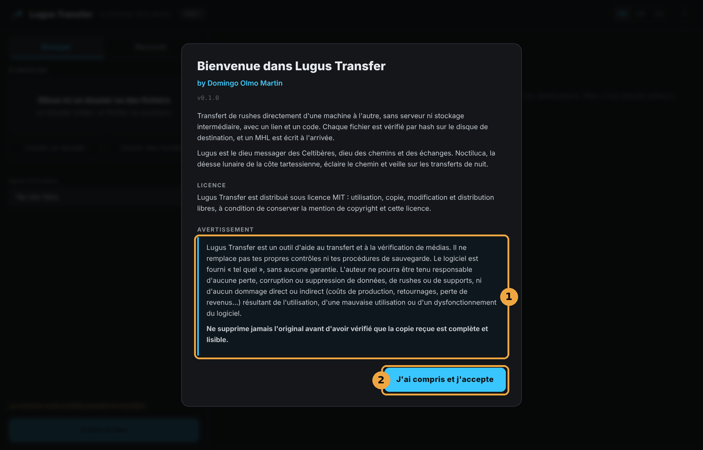

## 3. L'interface en un coup d'œil

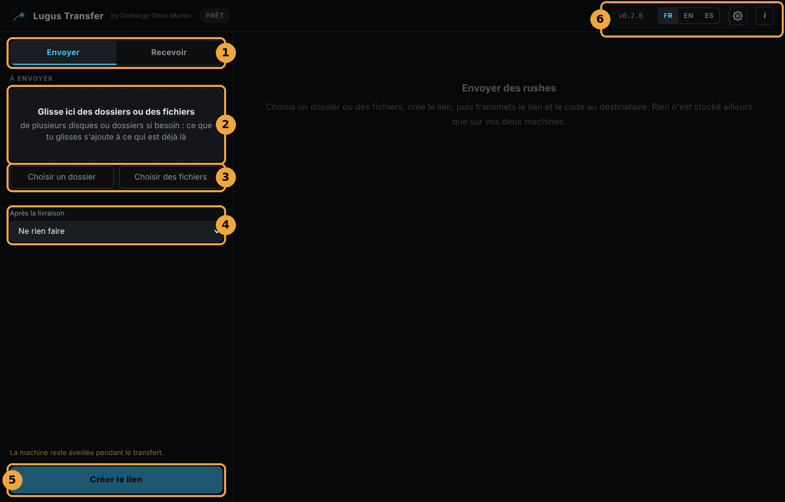

1. **Envoyer / Recevoir** : les deux modes de l'application. La même application sert des deux côtés.
2. **Zone de dépôt** : déposez-y un dossier, un fichier ou plusieurs fichiers.
3. **Choisir un dossier / Choisir des fichiers** : la même chose avec la fenêtre du système. « Choisir des fichiers » permet d'en sélectionner plusieurs d'un coup.
4. **Après la livraison** : ne rien faire, mettre l'ordinateur en veille ou l'éteindre une fois la livraison confirmée par le destinataire.
5. **Bouton principal** : **Créer le lien** pour envoyer, **Recevoir** pour recevoir, puis **Arrêter** pendant un transfert.
6. **FR / EN / ES** : change instantanément la langue de l'interface.
7. **À propos** (le bouton *i*) : version, licence et avertissement.

Pendant un transfert, la partie droite affiche :
- une frise d'**étapes numérotées**, l'étape en cours mise en évidence ;
- une **phrase d'état**, en clair, qui dit ce qui se passe et ce qu'il faut faire ;
- l'**avancement** : pourcentage, barre bleue pour les données transférées, barre verte pour les données déjà vérifiées sur le disque du destinataire, débit, temps restant, temps écoulé et chemin réseau (*réseau local*, *direct* ou *relais*) ;
- le **journal** et, en réception, la liste des **fichiers vérifiés**.

En haut, le badge à côté du nom de l'application résume l'état : *Prêt*, *Préparation*, *Publication*, *En attente*, *Envoi*, *Recherche*, *Choix*, *Réception*, *Noctiluca*, *Vérifié*, *Erreur*, *Arrêté*.

La ligne **La machine reste éveillée pendant le transfert** rappelle que Lugus Transfer empêche l'ordinateur de se mettre en veille tout seul pendant qu'il travaille.

## 4. Envoyer des rushes, pas à pas

### Étape 1 : choisir ce qu'on envoie

Déposez un dossier sur la fenêtre, ou cliquez sur **Choisir un dossier**. Vous pouvez aussi envoyer :
- **un seul fichier** : il arrivera seul dans le dossier du destinataire ;
- **plusieurs fichiers** : déposez-les ensemble, ou sélectionnez-les avec **Choisir des fichiers**. Ils doivent venir du même dossier.

Quand vous choisissez un dossier ou plusieurs fichiers, leur contenu s'affiche à droite, tout coché :

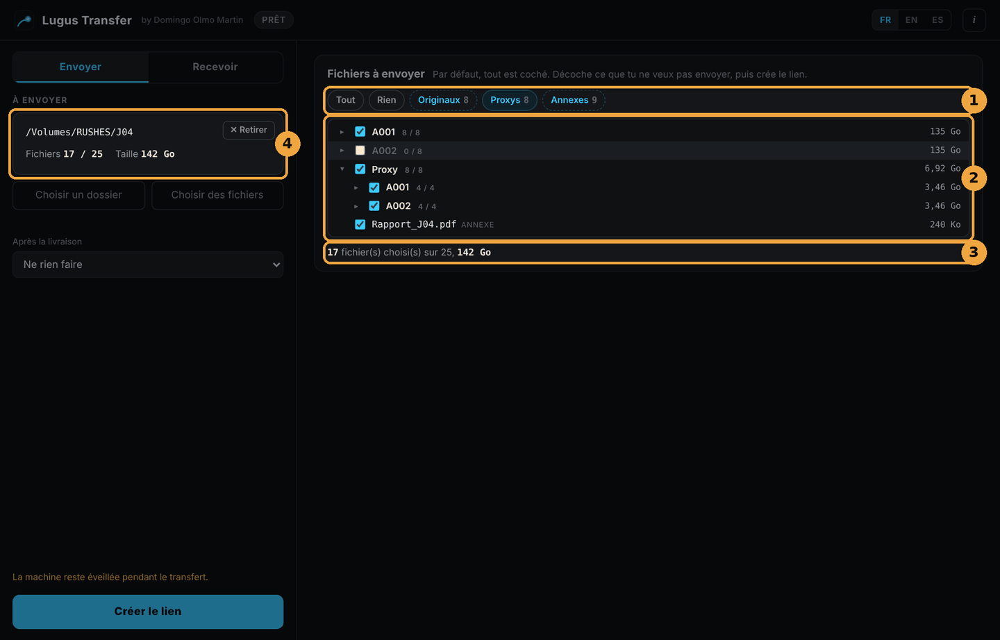

1. **Les filtres rapides** : **Tout**, **Rien**, puis **Originaux**, **Proxys** et **Annexes** (XML, LUT, son, rapports…) avec leur nombre. Un clic coche ou décoche toute la catégorie.
2. **L'arbre** du dossier : cliquez sur le nom d'un dossier pour l'ouvrir, cochez ou décochez un fichier ou un dossier entier. Une case à moitié remplie signifie qu'une partie du dossier est choisie.
3. **Le total** de ce qui sera envoyé : nombre de fichiers et taille.
4. **Le résumé** à gauche affiche le même total, par exemple *Fichiers 17 / 25*. Le bouton **✕ Retirer** efface tout pour repartir de zéro.

Pas besoin de cliquer sur Retirer pour changer d'avis : choisir un autre dossier ou d'autres fichiers remplace simplement le choix précédent.

### Étape 2 : après la livraison (facultatif)

Sous **Après la livraison**, choisissez ce que fait l'ordinateur une fois la livraison confirmée par le destinataire : **Ne rien faire**, **Mettre en veille** ou **Éteindre l'ordinateur**. Pratique quand on envoie un gros volume avant de partir.

### Étape 3 : créer le lien

Cliquez sur **Créer le lien**. Lugus Transfer analyse les fichiers, puis publie le lien sur le réseau :

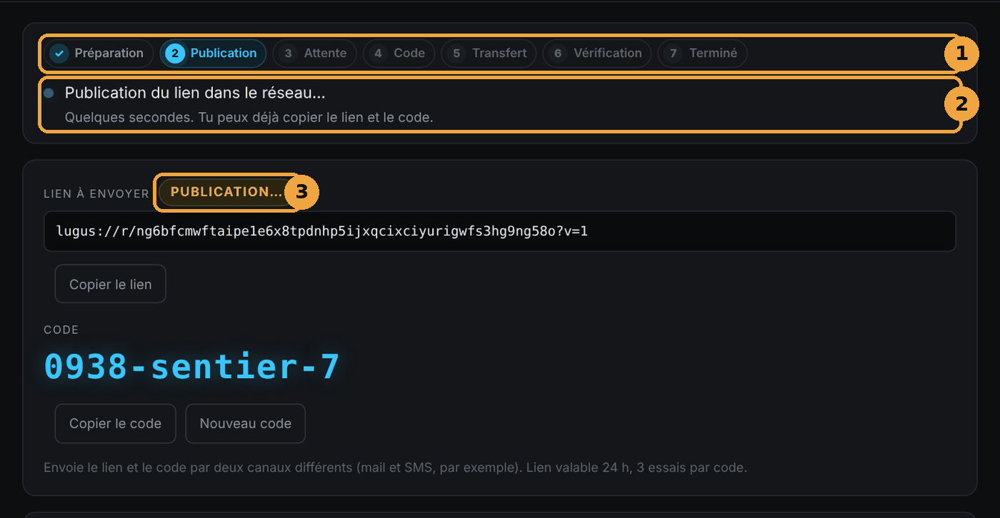

1. Les **étapes** passent de *Préparation* à *Publication*.
2. La **phrase d'état** indique que le lien est en cours de publication. Cela prend quelques secondes, et vous pouvez déjà copier le lien et le code.
3. Le **badge** à côté du lien affiche *Publication…*.

Dès que le lien peut être trouvé sur le réseau, le badge passe à **En ligne** :

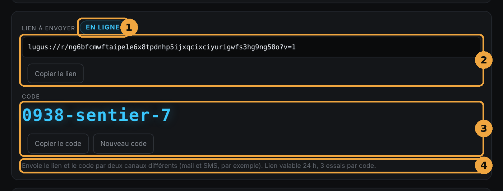

1. **En ligne** : le destinataire peut désormais joindre votre ordinateur. Si le badge affiche *Pas encore visible* après 90 secondes, le lien peut fonctionner quand même : envoyez-le, et laissez Lugus Transfer ouvert.
2. **Le lien** (`lugus://r/…`) et son bouton **Copier le lien**.
3. **Le code** (par exemple `4821-lanterne-7`), avec **Copier le code** et **Nouveau code**.
4. **Le rappel** : transmettez le lien et le code par **deux canaux différents**, par exemple le lien par mail et le code par SMS. Le lien est valable 24 heures, avec 3 essais par code.

Quelqu'un qui n'a que le lien ne peut rien en faire : il lui faut aussi le code.

### Étape 4 : attendre le destinataire

Laissez Lugus Transfer ouvert. Quand le destinataire saisit le code, la phrase d'état indique qu'un destinataire se connecte et que le code est vérifié.

- **Code incorrect** : le journal le signale et indique le nombre d'essais restants. Le destinataire peut réessayer après un court délai.
- **3 essais ratés** : le code est bloqué. Cliquez sur **Nouveau code** et transmettez le nouveau code. Le lien ne change pas.
- **Code accepté** : le destinataire choisit les fichiers qu'il veut. La phrase d'état le dit.

### Étape 5 : le transfert

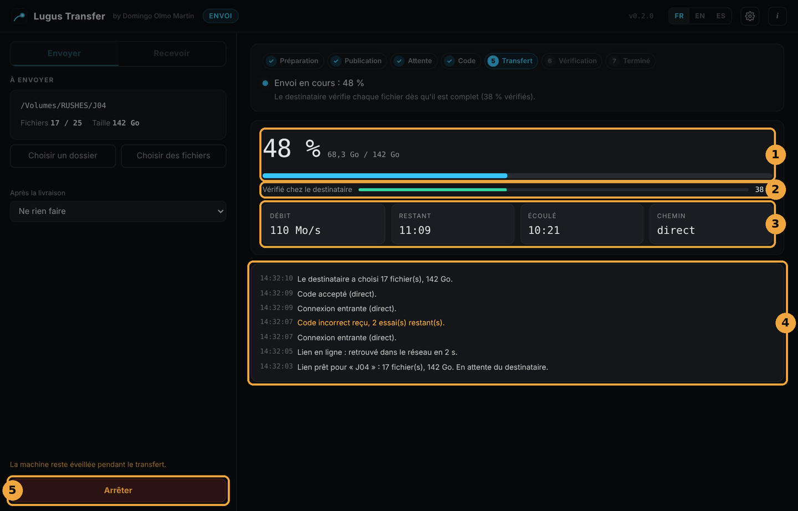

1. **Le pourcentage et la barre bleue** : ce que le destinataire a reçu.
2. **La barre verte** : ce qui a déjà été relu et vérifié sur le disque du destinataire. Chaque fichier est vérifié dès qu'il est complet : la barre verte suit la bleue.
3. **Débit, temps restant, temps écoulé et chemin réseau.**
4. **Le journal** : connexion, code, fichiers choisis par le destinataire.
5. **Arrêter** : met fin au transfert et ferme le lien. Rien de ce qui a déjà été reçu n'est perdu de l'autre côté (voir la section 8).

Les chiffres affichés sont ceux du destinataire : après une interruption et une reprise, les deux écrans affichent le même pourcentage.

### Étape 6 : la vérification chez le destinataire

Quand tout est envoyé, le transfert n'est pas encore fini. Le destinataire relit les derniers fichiers sur son disque :

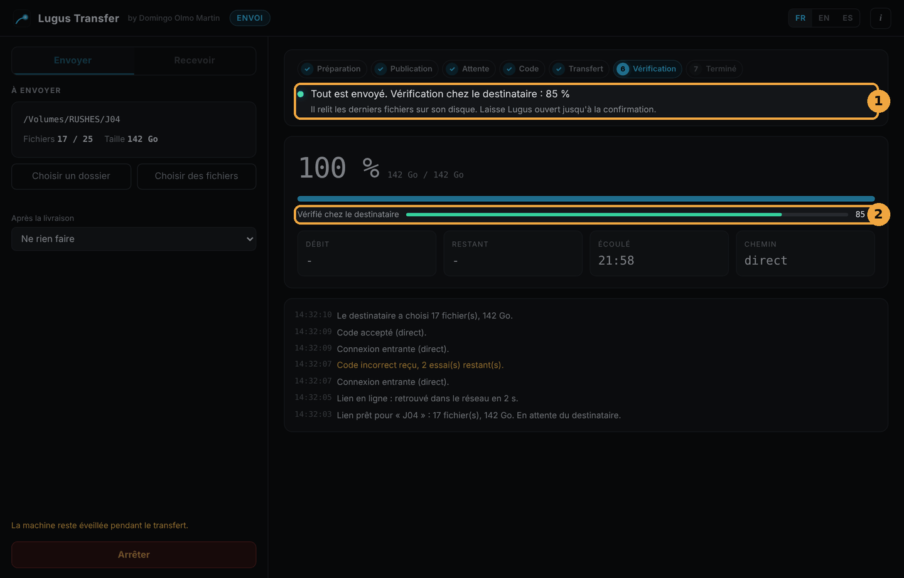

1. La **phrase d'état** affiche *Tout est envoyé. Vérification chez le destinataire*, avec le pourcentage.
2. La **barre verte** continue jusqu'à 100 %.

**Laissez Lugus Transfer ouvert jusqu'à la confirmation.**

### Étape 7 : livré

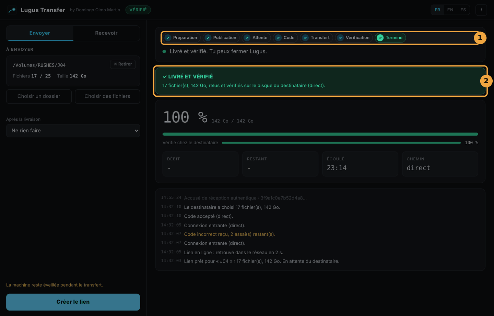

1. Toutes les étapes sont cochées et *Terminé* passe au vert.
2. Le bandeau **✓ LIVRÉ ET VÉRIFIÉ** donne le nombre de fichiers et la taille, relus et vérifiés sur le disque du destinataire.

Le destinataire a envoyé un accusé de réception authentifié : il ne peut venir que de la personne qui a saisi le bon code. Vous pouvez fermer Lugus Transfer. Le lien a alors servi : pour envoyer à quelqu'un d'autre, créez un nouveau lien.

## 5. Recevoir des rushes, pas à pas

### Étape 1 : lien, code et destination

Cliquez sur **Recevoir**, en haut à gauche.

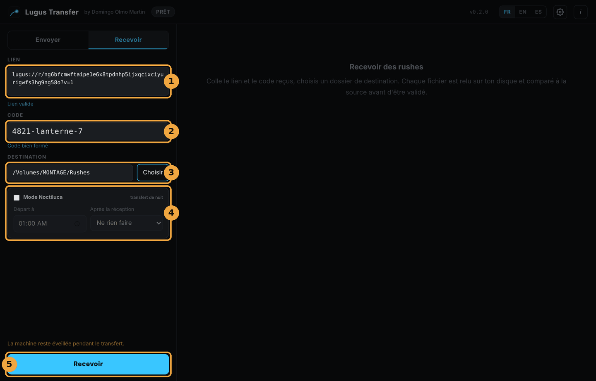

1. **Lien** : collez le lien reçu. *Lien valide* confirme sa forme.
2. **Code** : tapez le code. Il est vérifié sur votre ordinateur avant tout envoi : une faute de frappe est repérée tout de suite et **ne consomme jamais d'essai**.
3. **Destination** : cliquez sur **Choisir** et sélectionnez le dossier où arriveront les rushes. Un dossier arrive dans un sous-dossier à son nom, de même que plusieurs fichiers envoyés ensemble (au nom du dossier d'où ils viennent). Un fichier seul arrive directement dans la destination.
4. **Mode Noctiluca** : pour recevoir pendant la nuit (voir la section 6).
5. **Recevoir** : lance la réception.

Lugus Transfer cherche alors l'expéditeur sur le réseau. Cela prend en général quelques secondes. Si l'expéditeur n'est pas encore trouvé (fréquent juste après la création du lien), Lugus Transfer réessaie tout seul pendant 90 secondes et affiche le numéro de l'essai.

### Étape 2 : choisir les fichiers

Une fois le code accepté, le contenu proposé par l'expéditeur s'affiche, tout coché :

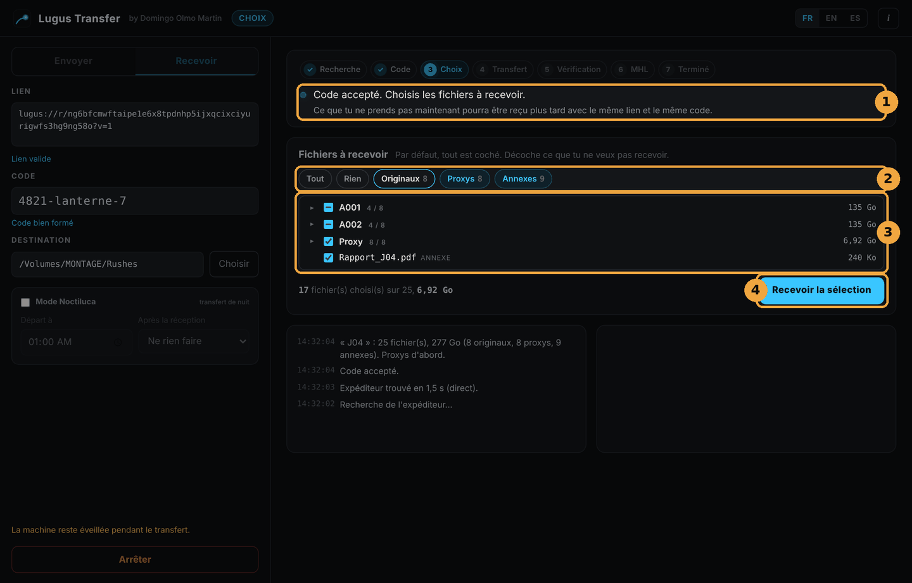

1. La **phrase d'état** vous invite à choisir les fichiers.
2. **Les filtres rapides** : **Tout**, **Rien**, **Originaux**, **Proxys**, **Annexes**. Ici, les originaux ont été décochés pour recevoir d'abord les proxys.
3. **L'arbre**, avec une case pour chaque fichier et chaque dossier.
4. **Recevoir la sélection** lance le transfert.

Ce que vous laissez de côté maintenant pourra être reçu plus tard avec le même lien et le même code : les fichiers déjà reçus et vérifiés sont sautés.

### Étape 3 : le transfert

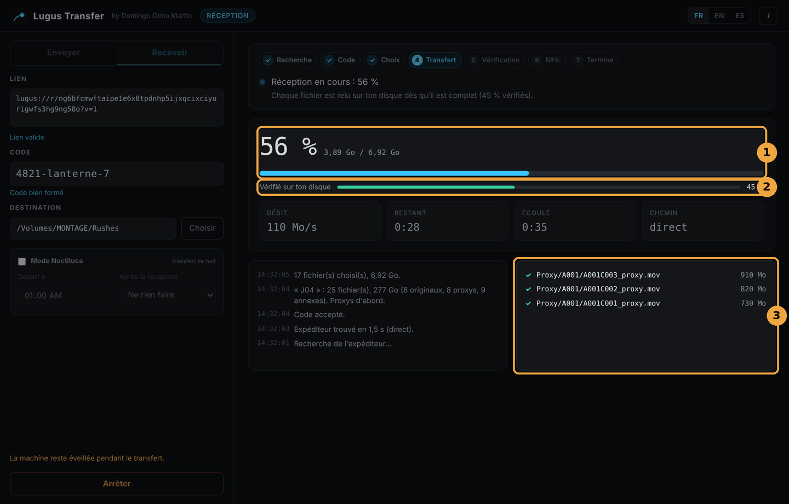

1. **Le pourcentage et la barre bleue** : ce qui a été reçu.
2. **La barre verte** : ce qui a déjà été relu sur votre disque et vérifié.
3. **Les fichiers vérifiés**, un par un, le plus récent en haut.

Les proxys et les fichiers annexes arrivent en premier, puis les originaux. Jusqu'à 4 fichiers sont reçus en même temps.

### Étape 4 : la vérification sur votre disque

Quand tout est reçu, Lugus Transfer finit de relire les derniers fichiers :

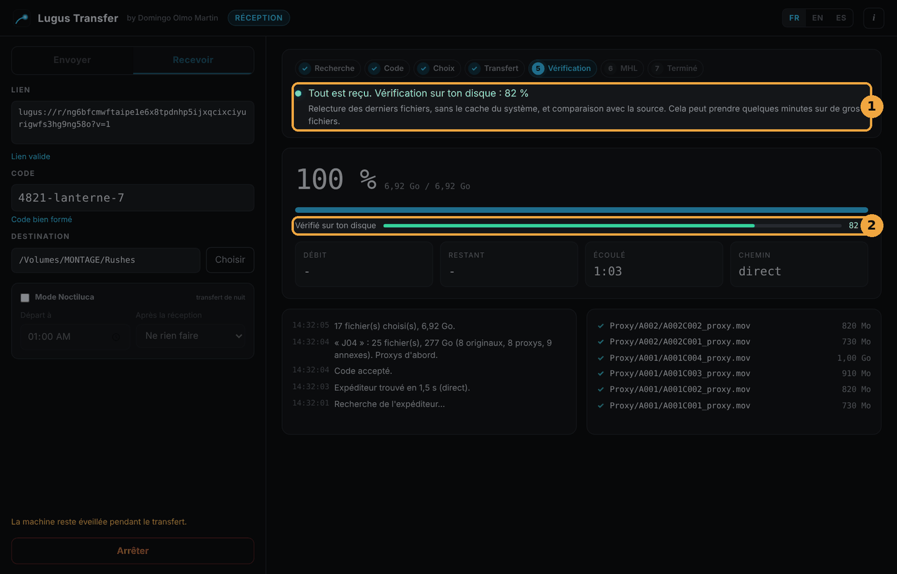

1. La **phrase d'état** affiche *Tout est reçu. Vérification sur ton disque*, avec le pourcentage. Sur de gros fichiers, cela peut prendre quelques minutes : chaque fichier est relu en entier sur le disque, sans le cache du système, et comparé à la source.
2. La **barre verte** continue jusqu'à 100 %.

### Étape 5 : MHL et accusé de réception

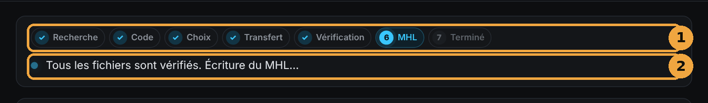

1. L'étape *MHL* est active.
2. La **phrase d'état** indique que tous les fichiers sont vérifiés et que le MHL est en cours d'écriture, puis que l'accusé de réception part chez l'expéditeur.

### Étape 6 : reçu

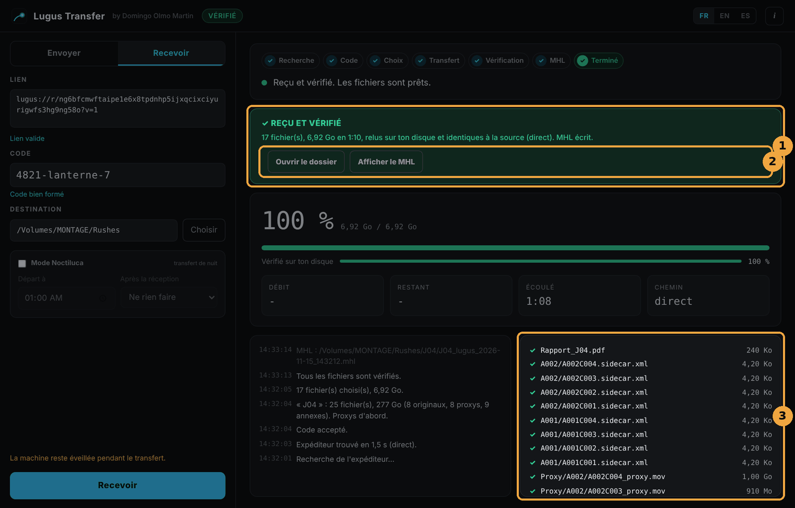

1. Le bandeau **✓ REÇU ET VÉRIFIÉ** : nombre de fichiers, taille, durée et chemin réseau.
2. **Ouvrir le dossier** ouvre le dossier reçu, **Afficher le MHL** montre le fichier MHL.
3. **La liste des fichiers vérifiés.**

Le MHL s'appelle `<nom>_lugus_<date>.mhl`, par exemple `J04_lugus_2026-11-15_143212.mhl`. Il n'écrase jamais un MHL déjà présent dans le dossier, comme celui écrit par Bandua sur le plateau.

## 6. Mode Noctiluca : recevoir pendant la nuit

Les gros transferts se font mieux la nuit, quand la connexion est libre et que personne n'a besoin de l'ordinateur. Le mode Noctiluca programme la réception et gère la fin tout seul.

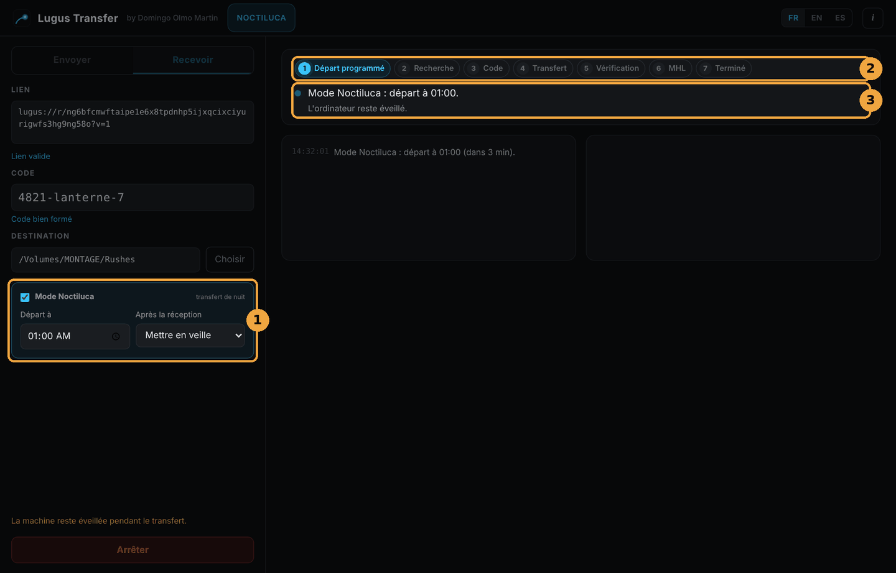

1. Cochez **Mode Noctiluca**, réglez l'heure de **Départ à** (01:00 par exemple), et choisissez ce qui se passe **Après la réception** : ne rien faire, mettre en veille ou éteindre l'ordinateur. Cliquez ensuite sur **Programmer la réception**.
2. Les étapes commencent par *Départ programmé*.
3. La phrase d'état rappelle l'heure de départ. L'ordinateur reste éveillé jusque-là.

Le lien et le code sont vérifiés avant l'attente : une faute de frappe se voit tout de suite, et pas à une heure du matin. Si l'heure est déjà passée aujourd'hui, la réception démarre le lendemain à cette heure.

En mode Noctiluca, personne n'est là pour choisir les fichiers : **tout ce que propose l'expéditeur est reçu**. L'ordinateur de l'expéditeur doit être allumé et Lugus Transfer ouvert à l'heure du départ.

Quand tout est vérifié, l'ordinateur se met en veille ou s'éteint. Sous Windows, l'extinction laisse 60 secondes pour l'annuler.

## 7. Ce que Lugus Transfer fait pour protéger vos rushes

Tout cela se passe en arrière-plan, sans réglage de votre part.

1. **Rien au milieu.** Les fichiers vont d'un ordinateur à l'autre. Ils ne sont jamais stockés sur un serveur. Même quand la connexion passe par un relais public, elle reste chiffrée de bout en bout : le relais ne fait que transmettre des données qu'il ne peut pas lire.
2. **Le code ne circule jamais.** Les deux ordinateurs se prouvent mutuellement qu'ils connaissent le code (SPAKE2) sans jamais l'envoyer. Quelqu'un qui intercepte le lien n'apprend rien, et n'a que 3 essais.
3. **Chaque bloc est contrôlé.** Les fichiers circulent par blocs de 4 Mo. L'expéditeur calcule le hash de chaque bloc au moment où il le lit sur son disque ; le destinataire le contrôle avant d'écrire le bloc.
4. **Écriture sûre.** Chaque fichier est d'abord écrit sous un nom temporaire (`.lugus-part`), avec un journal (`.lugus-journal`) qui note chaque bloc écrit. Un fichier ne prend son vrai nom **qu'une fois vérifié**. Un fichier qui porte son nom définitif est donc un fichier contrôlé.
5. **Vérification sur le disque, pas en mémoire.** À la fin de chaque fichier, le destinataire le relit sur le disque en contournant le cache du système, et compare chaque bloc, puis le fichier entier, au hash de la source (BLAKE3). Au moindre écart, le fichier est refusé et sa progression effacée, pour qu'il soit reçu à nouveau depuis le début.
6. **Dates d'origine conservées.** Les fichiers reçus prennent la date de modification de la source.
7. **Accusé de réception authentifié.** À la fin, le destinataire envoie à l'expéditeur un accusé que lui seul peut produire. C'est lui qui fait passer l'écran de l'expéditeur à *Livré et vérifié*.

## 8. Interruptions et erreurs

### Reprendre après une interruption

Coupure du réseau, fenêtre fermée, ordinateur mis en veille, **Arrêter** cliqué par erreur : le transfert peut reprendre exactement là où il s'est arrêté.

- **Côté expéditeur**, rien à faire : Lugus Transfer reste en attente, le lien reste valable (24 heures). Si l'expéditeur a fermé Lugus Transfer ou cliqué sur **Arrêter**, il crée un nouveau lien pour les mêmes fichiers et le transmet.
- **Côté destinataire**, relancez la réception avec le lien et le code (les mêmes, ou les nouveaux), et **la même destination**. Chaque fichier reprend après son dernier bloc écrit et contrôlé ; les fichiers déjà complets sont relus et vérifiés à nouveau, puis sautés.

Les deux écrans affichent le même avancement dès que les ordinateurs se reconnectent. Juste après une reprise, la barre verte peut repartir plus bas que la bleue : les fichiers déjà présents sont relus une fois de plus avant d'être comptés comme vérifiés.

### En cas d'erreur

| Ce que vous voyez | Ce que ça veut dire | Que faire |
|---|---|---|
| « Expéditeur pas encore trouvé, nouvel essai… » | Le lien n'est pas encore visible sur le réseau, ou le réseau répond mal. | Patientez : Lugus Transfer réessaie tout seul pendant 90 secondes. |
| « Expéditeur introuvable » (après 90 secondes) | L'ordinateur de l'expéditeur est éteint ou en veille, Lugus Transfer est fermé, ou le lien n'est pas le bon. | Vérifiez avec l'expéditeur que Lugus Transfer est ouvert, puis relancez. |
| « Code incorrect, N essai(s) restant(s) » | Le code saisi ne correspond pas. | Vérifiez le code. Attendez quelques secondes entre deux essais. |
| « Ce code est bloqué » | 3 essais ont échoué. | Demandez un nouveau code à l'expéditeur (**Nouveau code**). Le lien ne change pas. |
| « Connexion perdue » | Le réseau a coupé, ou l'autre ordinateur s'est mis en veille ou a été fermé. | Relancez la réception avec le même lien et le même code : elle reprend là où elle s'est arrêtée. |
| « Ce lien a expiré » | Plus de 24 heures se sont écoulées. | L'expéditeur crée un nouveau lien. |
| « Un autre fichier du même nom existe déjà à destination » | Un fichier de même nom, mais différent, se trouve déjà dans le dossier de destination. | Choisissez une autre destination, ou déplacez l'ancien fichier. Lugus Transfer n'écrase jamais rien. |
| « Le fichier relu sur le disque ne correspond pas à la source » | Ce qui a été écrit sur le disque n'est pas ce qui a été envoyé : problème de disque, de câble ou de connexion chez le destinataire. | Relancez la réception : le fichier est reçu à nouveau depuis le début. Si cela se reproduit, vérifiez le disque de destination. |
| « Un fichier a changé chez l'expéditeur depuis la création du lien » | Le fichier source a été modifié, ou était encore en cours d'écriture à la création du lien. | L'expéditeur attend la fin de la copie ou de l'export, puis crée un nouveau lien. |

## 9. Bonnes pratiques

- **Transmettez le lien et le code par deux canaux différents.** Le lien seul ne sert à rien, et c'est voulu.
- **Branchez les deux ordinateurs sur secteur.** Un transfert de plusieurs centaines de gigaoctets prend des heures.
- **Laissez un portable ouvert.** Lugus Transfer garde l'ordinateur éveillé, mais fermer le capot met en général un portable en veille malgré tout.
- **Demandez d'abord les proxys** si le montage doit commencer vite, puis les originaux, la nuit, en mode Noctiluca.
- **Attendez *Livré et vérifié*** avant de supprimer quoi que ce soit chez l'expéditeur, et gardez de toute façon les copies d'origine jusqu'à ce que les rushes soient sauvegardés chez le destinataire.
- **Contrôlez le MHL** avec [Bandua MHL Companion](https://github.com/tetsujin28/bandua-mhl-companion) quand les rushes changent encore de disque.

## 10. Questions fréquentes

**Quelle est la vitesse ?**
Celle que permet la plus lente des deux connexions, souvent le débit montant de l'expéditeur. Sur un même réseau local, le transfert va à la vitesse du réseau local. La case *Chemin* indique si la connexion est *réseau local*, *direct* ou *relais* ; un relais est plus lent.

**Y a-t-il une limite de taille ?**
Non. Lugus Transfer est fait pour de très gros fichiers et des journées de tournage entières.

**Les deux ordinateurs doivent-ils être allumés en même temps ?**
Oui. Rien n'est stocké entre les deux : les fichiers passent directement de l'un à l'autre. Le mode Noctiluca permet de programmer la réception à un moment où les deux sont libres.

**Puis-je envoyer à plusieurs personnes ?**
Un lien sert à une livraison. Pour envoyer les mêmes rushes à quelqu'un d'autre, créez un nouveau lien.

**Qu'est-ce qui passe sur Internet ?**
Pour être trouvé, l'expéditeur publie ses adresses réseau, signées par une clé à usage unique, dans la DHT publique de BitTorrent. Les fichiers, les noms de dossiers et le code ne sont jamais publiés : ils ne circulent que chiffrés, entre les deux ordinateurs.

**Le logiciel du monteur peut-il lire le MHL ?**
Oui, c'est du MHL 1.1 en xxHash64, le standard lu par Silverstack, ShotPut Pro, Hedge et Bandua MHL Companion.

**Lugus Transfer fonctionne-t-il sous Linux ?**
Pas pour l'instant. Le code reste compatible, mais il n'y a pas de version Linux tant qu'elle ne peut pas être testée. L'outil en ligne de commande peut être compilé sous Linux à partir du code source.

## 11. Avertissement et licence

Lugus Transfer est un outil d'aide au transfert et à la vérification de médias. Il ne remplace pas vos propres contrôles ni vos procédures de sauvegarde. Le logiciel est fourni « tel quel », sans aucune garantie. L'auteur ne pourra être tenu responsable d'aucune perte, corruption ou suppression de données, de rushes ou de supports, ni d'aucun dommage direct ou indirect (coûts de production, retournages, perte de revenus…) résultant de l'utilisation, d'une mauvaise utilisation ou d'un dysfonctionnement du logiciel.

**Ne supprimez jamais l'original avant d'avoir vérifié que la copie reçue est complète et lisible.**

© 2026 Domingo Olmo Martin. Publié sous [licence MIT](../LICENSE).
