

  

<h1 align="center">Lugus Transfer user guide</h1>

<b>Version 0.1.0 (beta) · Windows and macOS</b>

  <b>English</b> · <a href="GUIDE.fr.md">Français</a> · <a href="GUIDE.es.md">Español</a>

## Contents

1. [Overview](#1-overview)
2. [Installation](#2-installation)
3. [The interface at a glance](#3-the-interface-at-a-glance)
4. [Sending footage, step by step](#4-sending-footage-step-by-step)
5. [Receiving footage, step by step](#5-receiving-footage-step-by-step)
6. [Noctiluca mode: receiving overnight](#6-noctiluca-mode-receiving-overnight)
7. [What Lugus Transfer does to protect your footage](#7-what-lugus-transfer-does-to-protect-your-footage)
8. [Interruptions and errors](#8-interruptions-and-errors)
9. [Good practice](#9-good-practice)
10. [FAQ](#10-faq)
11. [Disclaimer and license](#11-disclaimer-and-license)

## 1. Overview

Lugus Transfer sends footage straight from one computer to another. The sender creates a link and a code, the recipient types them in, and the files travel directly between the two machines, encrypted end to end. There is no server in the middle, no cloud storage and no account.

The rule is the same as on set: **a transfer is only finished once the files have been checked on arrival.** Lugus Transfer reads every received file back from the recipient's disk, compares it with the source, and only then calls it "verified". An MHL file is written in the received folder, and the sender gets a delivery receipt.

Lugus Transfer is free, open source (MIT License), and needs no account or license key.

## 2. Installation

### Download

The files are on the [Releases page](https://github.com/tetsujin28/lugus-transfer/releases):

| System | File |
|---|---|
| Windows, no install | `Lugus_Transfer_x.y.z_portable.exe` |
| Windows, installer | `Lugus_Transfer_x.y.z_x64-setup.exe` or `.msi` |
| macOS (Intel and Apple Silicon) | `Lugus_Transfer_x.y.z_universal.dmg` |
| Command line (optional) | `lugus_x.y.z_windows.exe`, `lugus_x.y.z_macos` |

The sender and the recipient both need Lugus Transfer, but not the same system: a Mac can send to a PC and the other way round.

### First launch

The app is not signed yet, so your system shows a warning, only once:

- **Windows**: click "More info", then "Run anyway".
- **macOS**: double-click the app, then close the blocking message. Open System Settings > Privacy & Security, scroll down to the Security section and click "Open Anyway" next to the app's name, then confirm with your session password (asked only once). If the button does not appear, open Terminal and type `xattr -dr com.apple.quarantine ` followed by the app dragged onto the window.

Your browser may also flag the download as unusual. This is common for a new, unsigned app. Keep the file from the downloads panel. If in doubt, have it scanned on [VirusTotal](https://www.virustotal.com).

If your system or your firewall asks whether Lugus Transfer may use the network, allow it. That is how the two computers reach each other.

### Welcome window

On first launch, Lugus Transfer shows a disclaimer (1). Read it, then click **I understand and accept** (2). You can find it again under **About** (the *i* button).

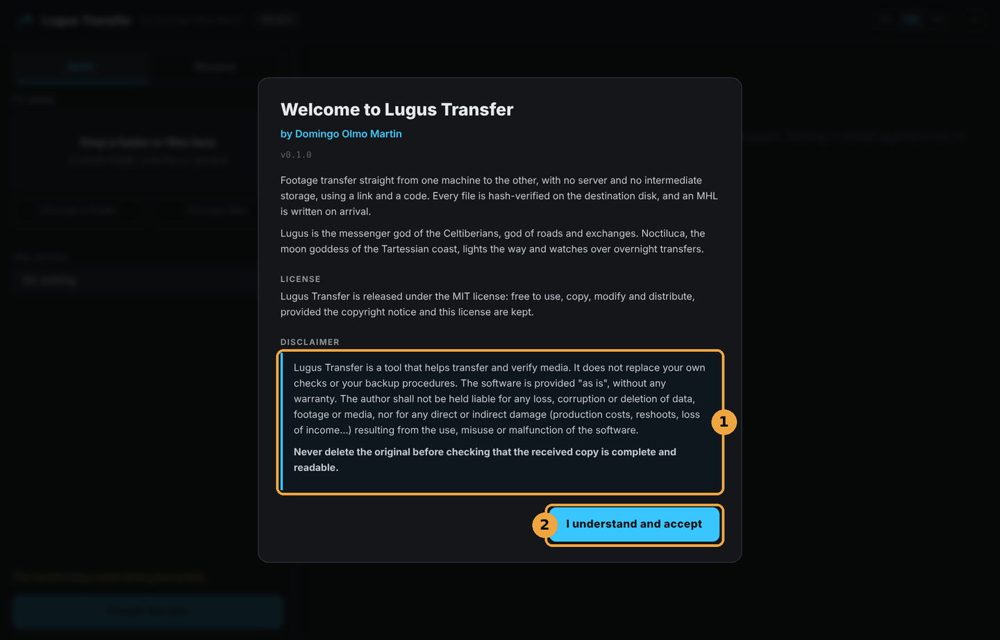

## 3. The interface at a glance

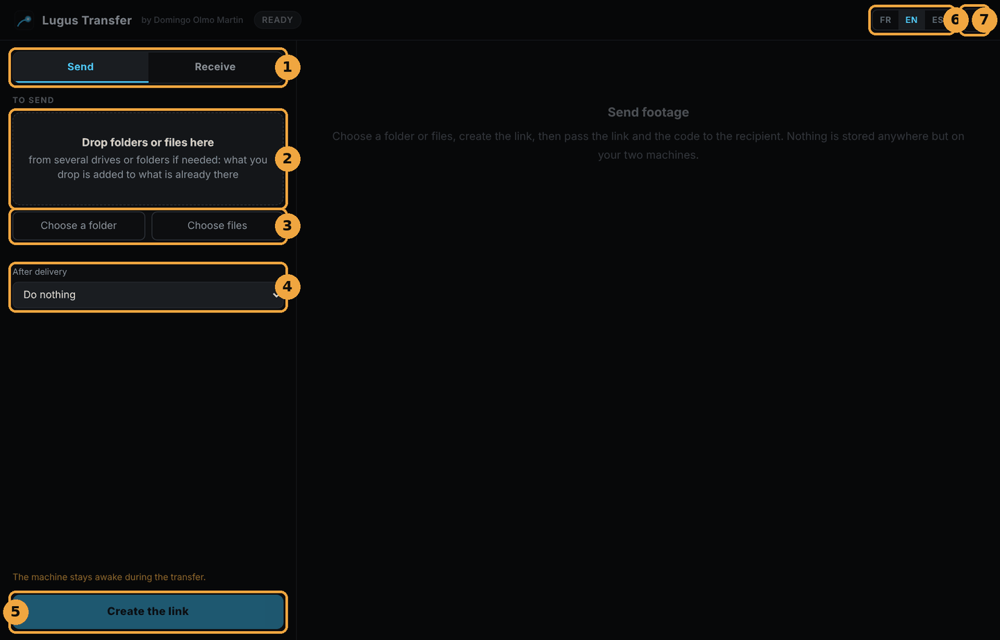

1. **Send / Receive**: the two modes of the app. The same app is used on both sides.
2. **Drop zone**: drop a folder, one file or several files here.
3. **Choose a folder / Choose files**: the same thing with the system window. "Choose files" lets you pick several files at once.
4. **After delivery**: do nothing, put the computer to sleep, or shut it down once the recipient has confirmed delivery.
5. **Main button**: **Create the link** when sending, **Receive** when receiving, then **Stop** while a transfer is running.
6. **FR / EN / ES**: switches the interface language instantly.
7. **About** (the *i* button): version, license and disclaimer.

During a transfer, the right side shows:
- a row of **numbered steps**, the current one highlighted;
- a **status line** in plain words, saying what is happening and what to do;
- the **progress**: percentage, a blue bar for the data transferred, a green bar for the data already verified on the recipient's disk, speed, time remaining, time elapsed and network path (*local network*, *direct* or *relay*);
- the **log** and, when receiving, the list of **verified files**.

At the top, the badge next to the app name sums up the state: *Ready*, *Preparing*, *Publishing*, *Waiting*, *Sending*, *Searching*, *Choosing*, *Receiving*, *Noctiluca*, *Verified*, *Error*, *Stopped*.

The line **The machine stays awake during the transfer** reminds you that Lugus Transfer stops the computer from going to sleep on its own while it works.

## 4. Sending footage, step by step

### Step 1: choose what to send

Drop a folder on the window, or click **Choose a folder**. You can also send:
- **one file**: it will arrive on its own in the recipient's folder;
- **several files**: drop them together, or select them with **Choose files**. They must come from the same folder.

When you choose a folder or several files, their content is listed on the right, everything ticked:

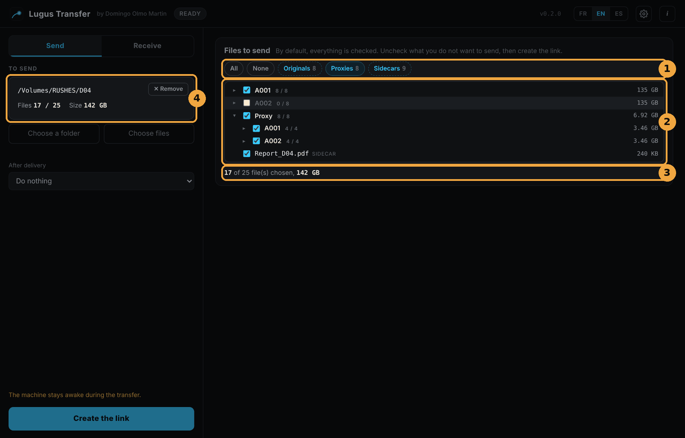

1. **Quick filters**: **All**, **None**, then **Originals**, **Proxies** and **Sidecars** (XML, LUT, sound, reports…) with their count. A click ticks or unticks the whole category.
2. **The tree** of the folder: click a folder name to open it, tick or untick a file or a whole folder. A half-filled box means part of the folder is selected.
3. **The total** of what will be sent: number of files and size.
4. **The summary** on the left shows the same total, for example *Files 17 / 25*. The **✕ Remove** button clears everything and starts again from scratch.

You do not need to click Remove to change your mind: choosing another folder or other files simply replaces the previous choice.

### Step 2: after delivery (optional)

Under **After delivery**, choose what the computer does once the recipient has confirmed delivery: **Do nothing**, **Sleep** or **Shut down the computer**. Useful when you send a big batch and leave.

### Step 3: create the link

Click **Create the link**. Lugus Transfer analyses the files, then publishes the link on the network:

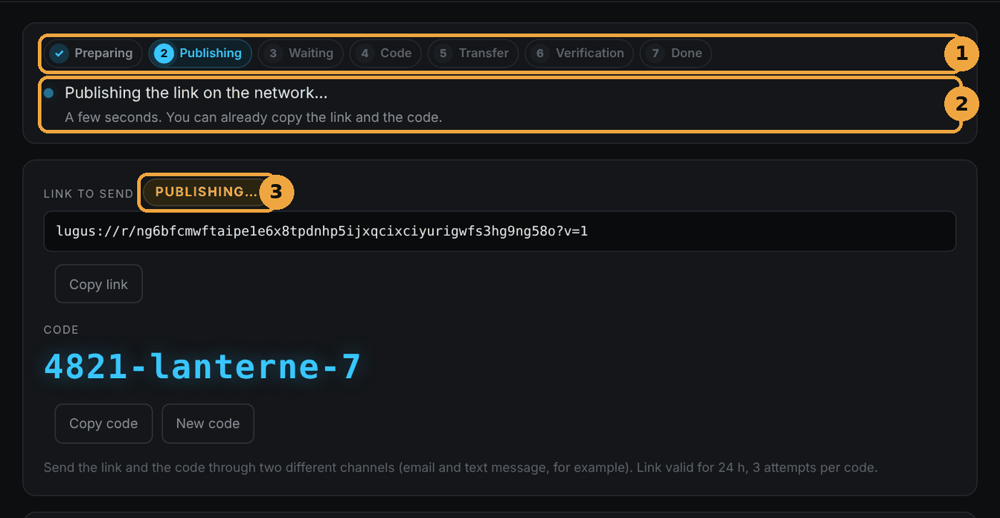

1. The **steps** move from *Preparing* to *Publishing*.
2. The **status line** says the link is being published. It takes a few seconds, and you can already copy the link and the code.
3. The **badge** next to the link reads *Publishing…*.

As soon as the link can be found on the network, the badge turns to **Online**:

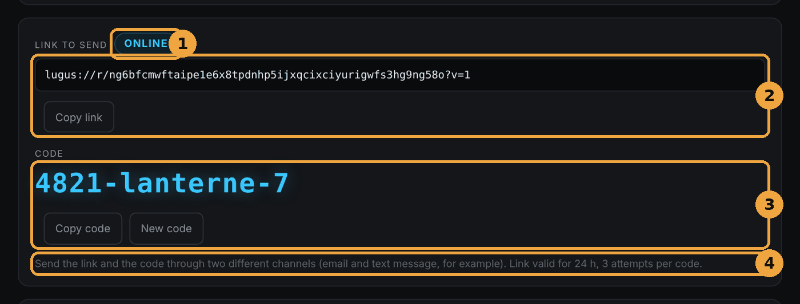

1. **Online**: the recipient can now reach your computer. If the badge reads *Not visible yet* after 90 seconds, the link may work anyway: send it, and keep Lugus Transfer open.
2. **The link** (`lugus://r/…`) and its **Copy link** button.
3. **The code** (for example `4821-lanterne-7`), with **Copy code** and **New code**.
4. **The reminder**: send the link and the code through **two different channels**, for example the link by email and the code by text message. The link is valid for 24 hours, with 3 attempts per code.

Someone who only has the link cannot do anything with it: they also need the code.

### Step 4: wait for the recipient

Keep Lugus Transfer open. When the recipient types the code, the status line says a recipient is connecting and the code is being checked.

- **Wrong code**: the log says so and shows how many attempts are left. The recipient can try again after a short delay.
- **3 failed attempts**: the code is locked. Click **New code** and send the new code. The link does not change.
- **Code accepted**: the recipient chooses the files they want. The status line says so.

### Step 5: the transfer

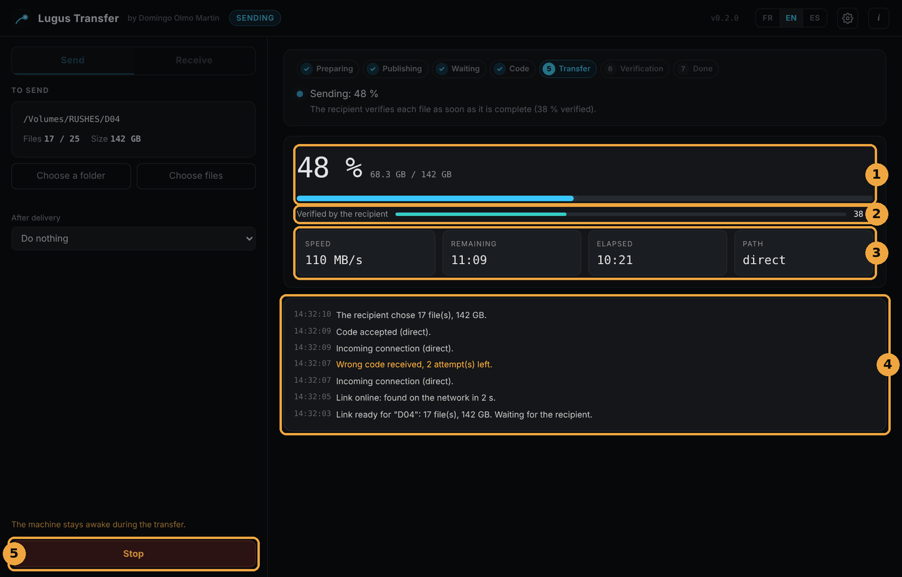

1. **The percentage and the blue bar**: how much the recipient has received.
2. **The green bar**: how much has already been read back and verified on the recipient's disk. Each file is verified as soon as it is complete, so the green bar follows the blue one.
3. **Speed, time remaining, time elapsed and network path.**
4. **The log**: connection, code, files chosen by the recipient.
5. **Stop**: ends the transfer and closes the link. Nothing already received is lost on the other side (see section 8).

The figures shown are those of the recipient: after an interruption and a resume, both screens show the same percentage.

### Step 6: verification on the recipient's side

When everything has been sent, the transfer is not over yet. The recipient reads the last files back from their disk:

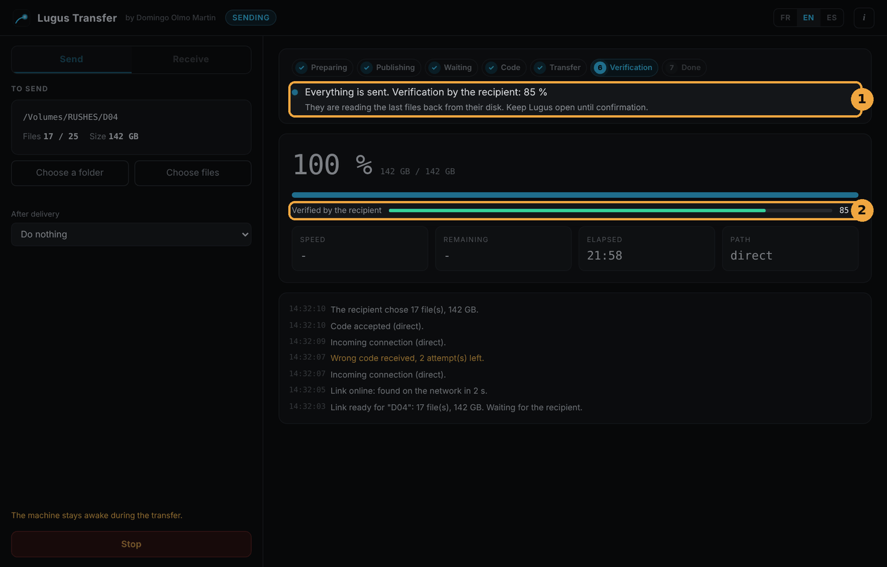

1. The **status line** reads *Everything is sent. Verification by the recipient*, with the percentage.
2. The **green bar** goes on up to 100 %.

**Keep Lugus Transfer open until the confirmation.**

### Step 7: delivered

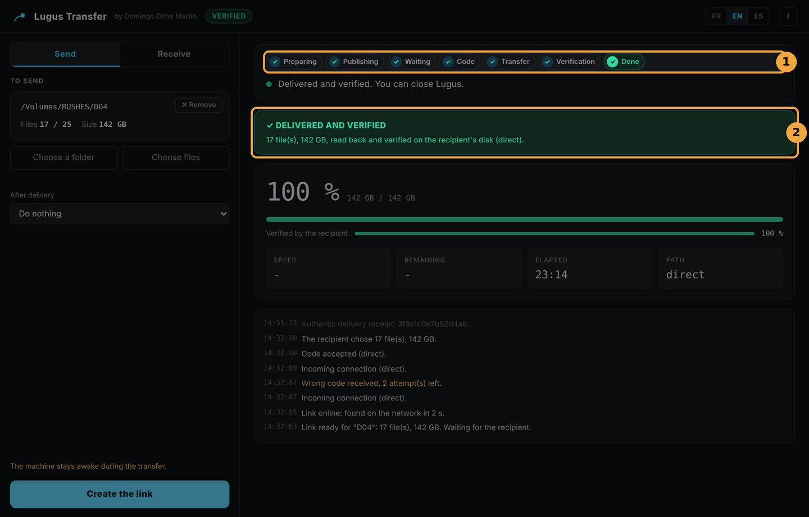

1. Every step is ticked and *Done* turns green.
2. The **✓ DELIVERED AND VERIFIED** banner gives the number of files and the size, read back and verified on the recipient's disk.

The recipient has sent an authenticated delivery receipt: it can only come from the person who typed the right code. You can close Lugus Transfer. The link is then used: to send to someone else, create a new link.

## 5. Receiving footage, step by step

### Step 1: link, code and destination

Click **Receive** at the top left.

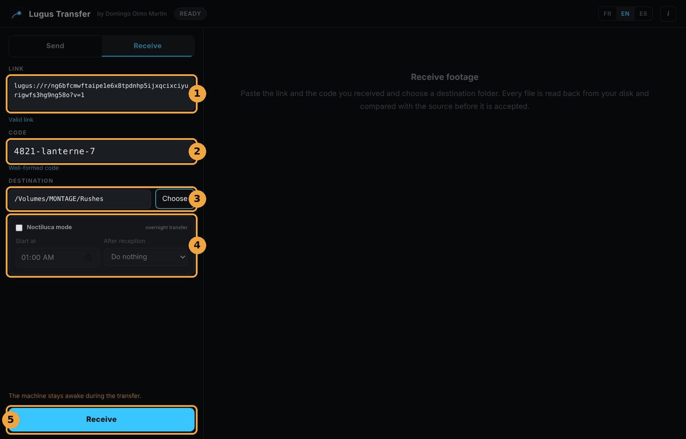

1. **Link**: paste the link you were sent. *Valid link* confirms its form.
2. **Code**: type the code. It is checked on your computer before anything is sent: a typo is caught right away and **never uses up an attempt**.
3. **Destination**: click **Choose** and pick the folder where the footage will arrive. A folder arrives in a sub-folder with its name, and so do several files sent together (with the name of the folder they come from). A single file arrives directly in the destination.
4. **Noctiluca mode**: to receive overnight (see section 6).
5. **Receive**: starts the reception.

Lugus Transfer then looks for the sender on the network. It usually takes a few seconds. If the sender cannot be found yet (common right after the link was created), Lugus Transfer tries again on its own for 90 seconds and shows the attempt number.

### Step 2: choose the files

Once the code is accepted, the content offered by the sender is listed, everything ticked:

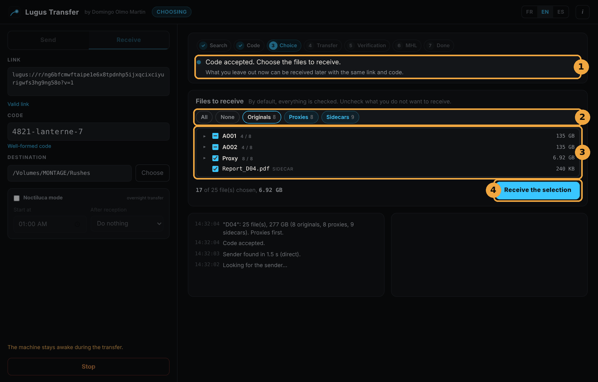

1. The **status line** asks you to choose the files.
2. **Quick filters**: **All**, **None**, **Originals**, **Proxies**, **Sidecars**. Here, the originals have been unticked to get the proxies first.
3. **The tree**, with a box for each file and each folder.
4. **Receive the selection** starts the transfer.

What you leave out now can be received later with the same link and the same code: files already received and verified are skipped.

### Step 3: the transfer

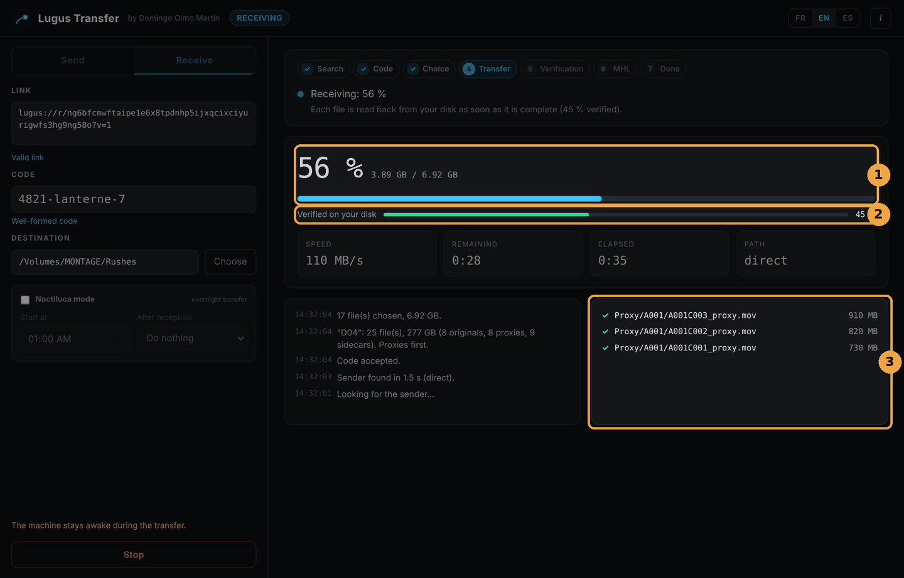

1. **The percentage and the blue bar**: what has been received.
2. **The green bar**: what has already been read back from your disk and verified.
3. **The verified files**, one by one, newest at the top.

Proxies and sidecar files come first, then the originals. Up to 4 files are received at the same time.

### Step 4: verification on your disk

When everything is received, Lugus Transfer finishes reading the last files back:

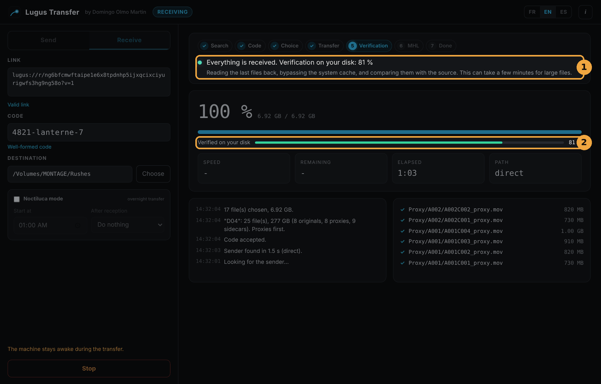

1. The **status line** reads *Everything is received. Verification on your disk*, with the percentage. With large files, this can take a few minutes: the whole file is read back from the disk, bypassing the system cache, and compared with the source.
2. The **green bar** goes on up to 100 %.

### Step 5: MHL and receipt

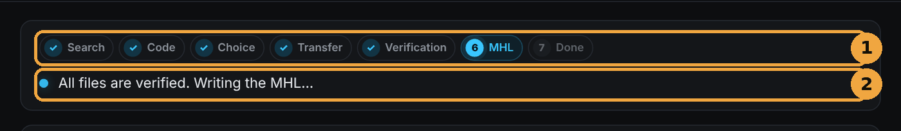

1. The *MHL* step is active.
2. The **status line** says every file is verified and the MHL is being written, then the delivery receipt is sent to the sender.

### Step 6: received

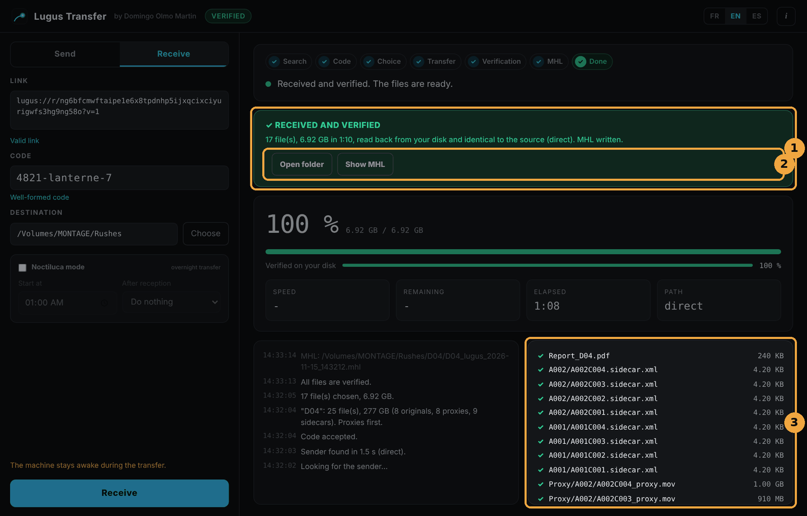

1. The **✓ RECEIVED AND VERIFIED** banner: number of files, size, duration and network path.
2. **Open folder** opens the received folder, **Show MHL** shows the MHL file.
3. **The list of verified files.**

The MHL is called `<name>_lugus_<date>.mhl`, for example `D04_lugus_2026-11-15_143212.mhl`. It never overwrites an MHL already in the folder, such as the one written by Bandua on set.

## 6. Noctiluca mode: receiving overnight

Big transfers are best done at night, when the connection is free and nobody needs the computer. Noctiluca mode schedules the reception and handles the end on its own.

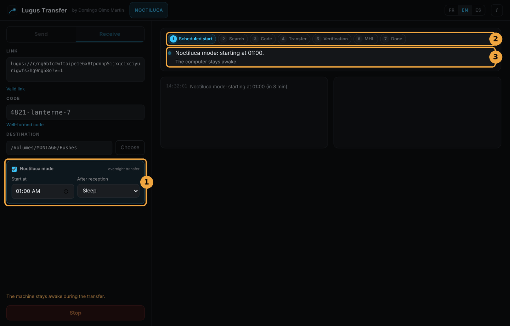

1. Tick **Noctiluca mode**, set the **Start at** time (01:00 for example), and choose what happens **After reception**: do nothing, sleep, or shut down the computer. Then click **Schedule the reception**.
2. The steps start with *Scheduled start*.
3. The status line gives the start time. The computer stays awake until then.

The link and the code are checked before the wait, so a typo shows up straight away and not at 1 in the morning. If the time has already passed today, the reception starts tomorrow at that time.

In Noctiluca mode, nobody is there to choose the files: **everything the sender offers is received**. The sender's computer must be on and Lugus Transfer open at the start time.

When everything is verified, the computer goes to sleep or shuts down. On Windows, the shutdown leaves 60 seconds to cancel it.

## 7. What Lugus Transfer does to protect your footage

All of this happens in the background, with nothing for you to set.

1. **Nothing in the middle.** The files go from one computer to the other. They are never stored on a server. Even when the connection goes through a public relay, it stays encrypted end to end: the relay only passes along data it cannot read.
2. **The code never travels.** The two computers prove to each other that they know the code (SPAKE2) without ever sending it. Someone who intercepts the link learns nothing, and only has 3 attempts.
3. **Every block is checked.** Files travel in 4 MB blocks. The sender computes the hash of each block when it reads it from its disk; the recipient checks it before writing the block.
4. **Safe writing.** Each file is first written under a temporary name (`.lugus-part`), with a journal (`.lugus-journal`) noting every block written. A file only gets its real name **once verified**. A file with its final name is therefore a checked file.
5. **Verification on the disk, not in memory.** At the end of each file, the recipient reads it back from the disk with the system cache bypassed, and compares each block, then the whole file, with the hash of the source (BLAKE3). If anything differs, the file is rejected and its progress erased, so it is received again from the start.
6. **Original dates kept.** Received files get the modification date of the source.
7. **Authenticated receipt.** At the end, the recipient sends the sender a receipt that only they can produce. That is what turns the sender's screen to *Delivered and verified*.

## 8. Interruptions and errors

### Resuming after an interruption

Network cut, window closed, computer gone to sleep, **Stop** clicked by mistake: the transfer can resume exactly where it stopped.

- **On the sender's side**, nothing to do: Lugus Transfer stays waiting, the link remains valid (24 hours). If the sender closed Lugus Transfer or clicked **Stop**, they create a new link for the same files and send it.
- **On the recipient's side**, start the reception again with the link and the code (the same ones, or the new ones), and **the same destination**. Each file resumes after its last block written and checked; files already complete are read back and checked again, then skipped.

Both screens show the same progress from the moment the computers reconnect. Right after a resume, the green bar may start lower than the blue one: files already present are read back once more before being counted as verified.

### When something goes wrong

| What you see | What it means | What to do |
|---|---|---|
| "Sender not found yet, trying again…" | The link is not visible on the network yet, or the network answers badly. | Wait: Lugus Transfer tries again on its own for 90 seconds. |
| "Sender not found" (after 90 seconds) | The sender's computer is off, asleep, or Lugus Transfer is closed, or the link is wrong. | Check with the sender that Lugus Transfer is open, then start again. |
| "Wrong code, N attempt(s) left" | The code typed does not match. | Check the code. Wait a few seconds between attempts. |
| "This code is locked" | 3 attempts failed. | Ask the sender for a new code (**New code**). The link does not change. |
| "Connection lost" | The network dropped, or the other computer went to sleep or was closed. | Start the reception again with the same link and code: it resumes where it stopped. |
| "This link has expired" | More than 24 hours have passed. | The sender creates a new link. |
| "Another file with the same name already exists at the destination" | A file with the same name, but different, is already in the destination folder. | Choose another destination, or move the old file. Lugus Transfer never overwrites anything. |
| "The file read back from the disk does not match the source" | What was written on the disk is not what was sent: a disk, cable or connection problem on the recipient's side. | Start the reception again: the file is received again from the start. If it happens again, check the destination disk. |
| "A file changed at the sender's since the link was created" | The source file was modified, or was still being written when the link was created. | The sender waits until the copy or export is finished, then creates a new link. |

## 9. Good practice

- **Send the link and the code through two different channels.** The link alone is useless, which is the point.
- **Keep both computers plugged in.** A transfer of several hundred gigabytes takes hours.
- **Leave a laptop open.** Lugus Transfer keeps the computer awake, but closing the lid usually puts a laptop to sleep anyway.
- **Ask for the proxies first** if the editor needs to start quickly, then the originals, overnight in Noctiluca mode.
- **Wait for *Delivered and verified*** before deleting anything at the sender's side, and keep the original copies anyway until the footage has been backed up at the recipient's.
- **Check the MHL** with [Bandua MHL Companion](https://github.com/tetsujin28/bandua-mhl-companion) when the footage moves again, from one drive to another.

## 10. FAQ

**How fast is it?**
As fast as the slower of the two connections allows, often the sender's upload speed. On the same local network, the transfer runs at local network speed. The *Path* box says whether the connection is *local network*, *direct* or *relay*; a relay is slower.

**Is there a size limit?**
No. Lugus Transfer is made for very large files and whole shoot days.

**Do both computers need to be on at the same time?**
Yes. Nothing is stored in between: the files go directly from one to the other. Noctiluca mode lets you schedule the reception for when both are free.

**Can I send to several people?**
One link is for one delivery. To send the same footage to someone else, create a new link.

**What goes on the Internet?**
To be found, the sender publishes its network addresses, signed by a one-time key, in the public BitTorrent DHT. The files, the folder names and the code are never published: they only travel encrypted between the two computers.

**Can the editor's software read the MHL?**
Yes, it is MHL 1.1 with xxHash64, the standard read by Silverstack, ShotPut Pro, Hedge and Bandua MHL Companion.

**Does Lugus Transfer run on Linux?**
Not for now. The code stays compatible, but there is no Linux build until it can be tested. The command line tool can be built on Linux from the source code.

## 11. Disclaimer and license

Lugus Transfer is a tool to help transfer and verify media. It does not replace your own checks or backup procedures. The software is provided "as is", without any warranty. The author cannot be held responsible for any loss, corruption or deletion of data, footage or media, nor for any direct or indirect damage (production costs, reshoots, loss of income…) resulting from the use, misuse or malfunction of the software.

**Never delete the original before checking that the received copy is complete and readable.**

© 2026 Domingo Olmo Martin. Released under the [MIT License](../LICENSE).
